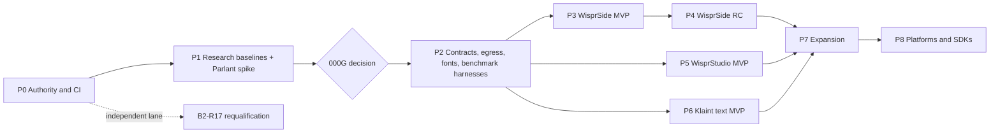

# Wispral engineering roadmap

**Status:** CANDIDATE. No dates are promised. Durations are engineering-day *estimates* for one familiar contributor or agent team on the founder's CPU-only machine, excluding review and governance latency, which dominates elapsed time (R-20). The packet graph in [packets.json](../../research/wispral-world-class/packets.json) is authoritative; this page summarizes it. **Phases are labels, not gates:** a packet starts as soon as its own dependencies are verified and its readiness authority opens it.

## 1. Phase overview

| Phase | Goal | Packets | Estimate (engineering days) |
| --- | --- | --- | --- |
| **P0** | Make execution legitimate | G1, C1, C2, R, PLAN, G2, F; B2-R17 (independent lane) | 4–8 + founder and review latency |
| **P1** | Prove the donors build and test as they are; decide Parlant v4 or v3 | CORE-00, SD-M0, ST-D00, ST-D00b, KT-01, then D0G | 6–10 |
| **P2** | Foundations the MVPs actually consume | CORE-01, CORE-07, DS-01, BM-00, BM-01, BM-02, BM-03 | 7–12 |
| **P3** | WisprSide Windows MVP (R1) | SD-M1, M2, M3, M4, M5, M6, M8, M9, M10, M11, DS-05 | 15–25 |
| **P4** | WisprSide RC (R3) | SD-R1, R2, R3, R4, R6, R7, R8, R9, PF-01 | 15–25 |
| **P5** | WisprStudio MVP (R1) | ST-D01, D02, D03, D04, D05, D08, D09, DS-07, BM-05 | 15–28 |
| **P6** | Klaint safe text MVP (R1), one hardened process | KT-03, KT-04, KT-05, KT-06, KT-07, KT-08, KT-09 | 15–25 |
| **P7** | Expansion (tier S/L) | BM-04, ST-D06 (conditional), ST-D07, KT-02, KT-10, DS-08, KV-01, KV-02, CORE-R1, A-01 | Coarse |
| **P8** | Platforms and SDKs | CORE-08, ST-D10, PL-SDK, PF-02 | Coarse |

**Concurrency rule (matches D0G):** at most two product Grains are open at once — WisprSide plus **one** of WisprStudio or Klaint. If capacity allows only one besides WisprSide, open **Klaint text first**: it needs no speech model, no GPU and no desktop packaging, whereas Studio quality work needs GPU cells the founder's machine lacks.

## 2. Where this plan changes the requested order (with evidence)

| Requested order | Change | Evidence |
| --- | --- | --- |
| Klaint planned in Phase 6 | **Parlant v4 spike (KT-01) moved into P1** | Parlant 4 removed strict canned responses, journeys, evaluations and the Plan hook |
| Studio (P5) strictly before Klaint (P6) | **P5 and P6 are alternatives after P2**, at most one alongside WisprSide; Klaint text recommended first | No GPU on HW-A; Klaint text has no speech dependency |
| Shared contracts and core runtime in Phase 2 | **Only what the MVPs consume:** contracts package, egress gates, fonts and benchmark harnesses. Rust crates, local-API profiles, the shared cancel harness and the Studio bridge moved to P7/P8 | Copy-first review: no MVP consumer |
| Studio fork assumed | **ST-D00b** compares Voicebox and VoiceStudio before committing | Copy-first review: VoiceStudio's advantages are mostly tier-S dubbing |
| Speech and multilingual in Phase 7 | **WB-AR preregistration and pilot in P2**; consented panel recruitment may start once the founder approves the consent program | Arabic is a first-class requirement; consent takes calendar time |

## 3. Critical path

G1 → C1 → C2 → R → PLAN → G2 → F → SD-M0 → (D0G, after CORE-00, ST-D00, ST-D00b, KT-01) → BM-02 → SD-M9 → SD-M3 → SD-M4 → SD-M5 → SD-M6 (needs CORE-01) → DS-05 → **R1 WisprSide internal alpha**.

Parallel after F: CORE-00, SD-M0, ST-D00, ST-D00b, then KT-01 (after CORE-00). Parallel after D0G: CORE-01, CORE-07, DS-01, BM-00 → BM-03, BM-01 (after CORE-07), SD-M2, SD-M11.

## 4. Capacity and execution assumptions

- One engineering agent team; reviews batched per phase.
- Execution contexts are explicit per packet: GitHub-hosted CI (Windows runners are Server images running as administrator, with no audio input), **manual runs on HW-A** with recorded evidence (elevated windows, secure desktop, egress attribution via WFP audit event 5156 or ETW, usability and screen-reader passes), and pure tests. Windows 11 Home has no Hyper-V Manager or Windows Sandbox, so clean-install VM cells need either another machine or a free cloud VM the founder already has.
- The founder supplies: ratifications (G1, G2), qualifying reviewers, merge approvals, the Wispral outbound license, the signing route and budget, the consent program, and fork-repository visibility (private repositories consume Actions minutes, and Windows minutes count double).
- No paid compute, subscriptions or hardware are assumed.

## 5. Milestone release criteria

Each R-stage uses the gates in [WISPRAL_RELEASE_QUALITY.md](WISPRAL_RELEASE_QUALITY.md). R2 and later require the founder's explicit green light; nothing is published or distributed publicly without it.
