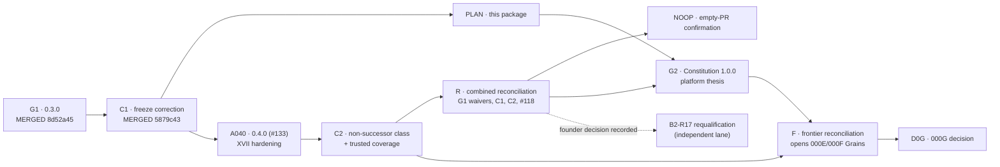

# Governance and CI reconciliation — executable sequence (Phase 0)

**Status:** CANDIDATE PLAN, revised after independent security and testability review (see [INDEPENDENT_REVIEW.md](../../research/wispral-world-class/INDEPENDENT_REVIEW.md)). This document authorizes nothing. It proposes the smallest legitimate sequence by which the founder can make the platform plan executable without weakening, bypassing, disabling, relabeling or suppressing any check. Full evidence: [governance and CI research report](../../research/wispral-world-class/evidence/research-reports/GOVERNANCE_CI_RESEARCH.md), with reproduction scripts and outputs in [evidence/governance/](../../research/wispral-world-class/evidence/governance/trigger_matrix.txt). It refines PR #124's [amendment proposal](WISPRAL_GOVERNANCE_AMENDMENT_PROPOSAL.md) and PR #125's finding M1, and absorbs #126's control work.

**Live state (2026-11-08):** `main` = `5879c43c7a389bd460955f2e181e8bd70f0ecee5`. G1 merged as `8d52a45` (#129) and C1 as `5879c43` (#130). Sections 1, 3 and 4.1 keep the pre-G1 analysis (base `edacdf7504302cc91ff7138bc6ac2d391e4df1f4`) as history. Sections 2, 4.2, 5, 7 and 8 are the live sequence. Branch protection: none (classic protection 404, rulesets `[]`). **Missing protection is not permission**; repository governance still binds, and every merge that carries a preserved red check is recorded as an explicit owner act.

---

## 1. Why execution is blocked today

| # | Blocker | Evidence | Classification |
| --- | --- | --- | --- |
| B-1 | **Mission contradiction.** `AGENTS.md` and Constitution 0.2.1 define Wispral as a coding-agent control plane and "not a dictation application"; the anti-roadmap and invariant A12 conflict with the three products; the 000 spec excludes TTS product work | `AGENTS.md:3`; `PROGRAM_ROADMAP.md`; `ARCHITECTURE_INVARIANTS.md` A12; `specs/000-founding-research/spec.md` | Needs a **major** amendment (G2) |
| B-2 | **`verify-b2r16-freeze` fails on every PR and on `main` itself** (`B2R16 actual candidate range scope drift`) | `REPRODUCED` on `edacdf7`, #124, #126, #120; `RUNTIME_OBSERVED` on #120–#125. No path filter (`000b2-public-b2r16-freeze.yml:3-5`); fixed historical base (`verify_b2r16.py:123-130`); requires `completed_recovery_tasks == [B2R13,B2R14,B2R15]` (`:138-140`). Because the range check runs first (`:271-273`), the verifier's later frozen-identity checks are **masked** on every later PR | **Fail-closed over-application** that also hides later checks. Principle XVI covers fail-open defects only |
| B-3 | **Two B2 trusted scope gates permanently lock the frontier files** (`specs/CURRENT.md`, `CURRENT_STATE.md`, …) for every non-B2 PR | `REPRODUCED` harness running main's inline gate programs (matches CI on #126 and #120). After B2 completes, the gate raises `None candidate path scope violation` (`000b2-public-attempt-003-trusted-pr.yml:153-158`) | **Fail-closed over-application**, permanent |
| B-4 | **#118 merged with a red required verifier and no approving review**, recorded nowhere canonical | Run 34416457849; two CodeRabbit `COMMENTED` reviews; `reviewDecision` empty | Governance debt: an undocumented exception |
| B-5 | **Product-code gate** | `CURRENT_STATE.md`; `specs/CURRENT.md` | Legitimate; opened only by 000G |
| B-6 | **No qualifying independent reviewer is configured** | `recovery-v2.md:187`; Constitution XVI.7 | Defined in §5 below; founder must name one |
| B-7 | **Trusted coverage gap:** `research/000b2-entry/**`, `research/000b1/**` and `000b2-entry-*.yml` are guarded only by candidate-controlled `pull_request` workflows, not by a base-defined gate | Security review finding 1/3 (`SOURCE_VERIFIED` path filters) | Strengthening needed in C2 |

**Status of each blocker on 2026-11-08:**

| Blocker | Status |
| --- | --- |
| B-1 | Open until G2 |
| B-2 | **Resolved by C1** (`5879c43`). The freeze is base-defined, and its `push` run on `main` passes ([run 42446197959](https://github.com/TheHalfMoon/Wispral/actions/runs/42446197959)) |
| B-3 | Open until C2. It now also shows as a red recovery `push` run on `main` ([run 42446198003](https://github.com/TheHalfMoon/Wispral/actions/runs/42446198003)), a preserved failure |
| B-4 | Open until R |
| B-5 | Legitimate; opened only by 000G |
| B-6 | **Resolved in practice:** a different-vendor reviewer route (DeepSeek V4.1 Flash via OpenCode, cost 0) qualified #130 |
| B-7 | Open until C2 |

## 2. Live sequence (lane first)

| Step | Status | Paths | Expected red checks | Review class | Rollback |
| --- | --- | --- | --- | --- | --- |
| **G1** | **MERGED** `8d52a45` (#129). The owner waived the qualifying review; recorded on #129 | `CONSTITUTION.md` | (was) `verify-b2r16-freeze`, preserved under the transitional clause | Constitution-required (waived; A040 ratifies) | Governed revert |
| **C1** | **MERGED** `5879c43` (#130). DeepSeek review: round 1 REQUEST_CHANGES (4 blocking), round 2 APPROVE (0 blocking) | freeze workflow, preservation checker and tests | (was) the two B2 scope gates, preserved under XVII item 5; the freeze job absent and replaced by a dispatch run | Constitution-required | Governed revert restores the original workflow (its PR shows a red freeze check by design) |
| **PLAN** | Open (#128). Needs its qualifying review | this package (docs and research only) | **None** (the freeze is base-defined since C1) | Ordinary plus qualifying review | Revert |
| **A040** | Open (#133, drafted by another session on the owner's account) | `CONSTITUTION.md` | **None after its next push.** Its only red run (42444655346) predates C1 and used the old candidate-defined freeze. Any new push, such as the required #130 text update, triggers the base-defined freeze, which passes on `CONSTITUTION.md`-only changes | Constitution-required, qualifying review not waivable | Governed revert |
| **C2** | Not started. **Needs A040**: under 0.3.0 its immutable-control boundary failure cannot be preserved (audit A3) | recovery and trusted-pr workflows, `verify_attempt_002_invalidation.py` | the two scope gates and the immutable-control boundary, preserved under amended item 5 | Constitution-required | Governed revert |
| **R** | Not started | `docs/canonical/TRUSTED_CONTROL_REPAIRS.md` (outside every B2 path filter); `AGENTS.md` reading-order line | None | Qualifying review (amended item 10) | Revert |
| **NOOP** | Not started | throwaway probe PRs only (empty; one allowlisted-section probe) | None. Every workflow's latest `main` push run green | Ordinary | Close the probes |
| **G2** | Not started | `CONSTITUTION.md`, `AGENTS.md`, `ARCHITECTURE_INVARIANTS.md`, `PROGRAM_ROADMAP.md`, `specs/000-founding-research/{spec,plan}.md` | None | Constitution-required | Governed major revert |
| **F** | Not started | `specs/CURRENT.md`, `docs/canonical/CURRENT_STATE.md` (allowlisted sections only, §4.2), `specs/000-founding-research/tasks.md`, new `specs/000E-platform-feasibility/{spec,plan,tasks}.md`, new `specs/000F-provenance-intake/{spec,plan,tasks}.md` | None (passes the non-successor class) | Ordinary | Revert |
| **D0G** | Not started | 000G closeout and the selected Grain specs | Per touched paths; none expected | Constitution-required | Revert |

**If A040 is rejected or delayed.**

- Under 0.3.0 item 10, a C1-only reconciliation (R1, same path, records only) must precede C2.
- C2 remains blocked, because 0.3.0 cannot preserve its immutable-boundary failure.
- An amendment equivalent to A040's A3 text is the only legitimate exit.

**Superseded sequences.** The V3 execution sequence on #124's branch (#131 and #134) is superseded by this table. Draft #127 is superseded by #129.

**After C2:** the founder is advised to enable a repository ruleset with exactly one required check — a base-defined aggregator job that always runs and fails if any applicable check is red, absent, skipped, pending or cancelled. Path-filtered checks must not be made *required* individually, or they deadlock as "absent".

**B2 coexistence.** ATTEMPT-003 stays frozen. G1, C1, C2, R, PLAN, G2 and F change no readiness file, task scope, frozen input, `recovery-v2*.md` or B2 evidence; C1/C2 tests prove B2 task and reconciliation classification is unchanged. After C2 and the founder's B2R17 decision in R, PR #120 merges `main`, is fully requalified at its new head (stale evidence does not transfer, `recovery-v2.md:106`), gets a fresh qualifying review, and continues independently. **Only speech-bearing packets wait on B2/B4 or a new speech-evaluation Grain.**

**Rejected alternatives** (research report §7): amendment first (red checks with no authority); one combined amendment (couples CI integrity to the platform pivot; second choice); path-filtering the freeze workflow alone (itself a control change, weaker, leaves the frontier locked); relocating the frontier (path-dodging); waiting for B2 (the lock is permanent).

## 3. Proposed text for G1 (Constitution 0.2.1 → 0.3.0)

> **Historical. Adopted with revisions** as #129 (merge `8d52a45`, revision 3). The canonical text is `CONSTITUTION.md` on `main`. The quotation below is the proposal as last synced, kept as history. #133 (A040) proposes 0.4.0.

> **Principle XVII — Correcting an over-applied benchmark control is explicit, narrow and proven.**
>
> **Scope.** This principle applies only to the controls listed in the annex below. Adding a control to the annex requires a constitutional amendment. It never applies to a control, or to any step of a control, whose purpose is security, consent, tenant isolation, network egress, credential handling, release or signing; such a control or step changes only through an ordinary reviewed change that strengthens it, or through Principle XVI. Where an annexed file also contains such a step (for example the immutable-control-blob boundary in `000b2-public-attempt-003-trusted-pr.yml`), that step MUST remain unchanged in effect, proven by its existing negative fixtures.
>
> **Annex (initial):** `.github/workflows/000b2-public-b2r16-freeze.yml`; `research/000b2-public/verify_b2r16.py`; the scope-classification steps of `.github/workflows/000b2-public-attempt-003-recovery.yml` and `.github/workflows/000b2-public-attempt-003-trusted-pr.yml`; the scope-classification functions of `research/000b2-public/verify_attempt_002_invalidation.py`.
>
> **Defect.** An annexed control is *over-applied* only when (a) canonical authority text assigns it to a named candidate class, and (b) it is shown, by reproduction on canonical `main` or on a minimal synthetic candidate outside that class, to reject candidates outside that class or `main` itself.
>
> **Requirements.** A correction is authorized only through a dedicated control-correction PR that:
> 1. MUST describe the defect, the exact canonical authority base, the exact changed paths, the expected conflict with the pre-correction controls, compatibility, security and privacy impact, and the affected specifications (as Principle XVI.3 requires);
> 2. MUST change only the exact annexed control paths required, any new verifier or test files those controls invoke, and its evidence directory;
> 3. MUST prove that detection on the authorized class is preserved in full: identical verdicts on an in-class corpus that includes every previously rejected malformed candidate, plus at least one negative fixture for every rejecting branch of the corrected control, all executed from trusted (base-pinned, hash-verified, isolated-interpreter) code;
> 4. MUST NOT broaden any task, reconciliation, execution, decode, scoring, comparative-claim, product or completion authority; a newly accepted candidate class carries no execution authority;
> 5. MUST preserve each pre-correction failure as conflict evidence, never relabeled, suppressed or rerun to green, and MUST prove: (a) **cause** — the deterministic gate harness (`research/wispral-world-class/evidence/governance/run_inline_gate.py` or its successor) evaluates the gate's base-defined program on the candidate and on the same candidate with the declared control bytes reverted; the failure occurs on the former and not on the latter, and the gate is actually evaluated in both runs (an absent or untriggered gate proves nothing); and (b) **no concealment** — because a failing gate stops at its first failing check, every later step of that gate is executed separately by the harness from base-pinned code on the candidate and either passes or fails only with a failure that is itself preserved and proven under this item, and every failing step is executed again on the candidate with only the over-applied classification neutralized by a declared minimal change, and then passes. Each preserved failure MUST be individually evidenced and MUST occur before any dependent execution or state transition. A preserved failure that recurs on the post-merge run of the same gate on canonical `main` remains preserved conflict evidence and MUST be recorded by the reconciliation in item 10 ([#129](https://github.com/TheHalfMoon/Wispral/pull/129) revision 3; evidence in [`evidence/governance/c1/`](../../research/wispral-world-class/evidence/governance/c1/README.md));
> 6. MUST satisfy every other exact-head gate required by canonical authority and applicable to the candidate; a required gate that is absent, skipped, pending, cancelled or failed is not satisfied, except the failures preserved under item 5;
> 7. MUST receive a qualifying independent substantive review (Governance item 7) of the exact final range, with all blocking findings resolved before merge;
> 8. MUST use a guarded normal merge bound to the reviewed head, recorded as an explicit owner act;
> 9. MUST, after merge, verify the actual canonical merge SHA and ancestry and exercise the corrected control against that exact canonical state by a deterministic verifier or a dispatched canonical workflow; and
> 10. MUST be recorded by a separate canonical reconciliation before dependent work relies on it.
>
> This authority MUST NOT substitute for an ordinary required gate. If preservation, cause, non-concealment or strict non-broadening cannot be demonstrated, the project remains blocked.
>
> **Transitional clause.** Until correction C1 merges, the failure `B2R16_ATTEMPT_003_FREEZE=FAIL: B2R16 actual candidate range scope drift`, reproduced on canonical `edacdf7504302cc91ff7138bc6ac2d391e4df1f4`, may be preserved as evidence on exactly two PRs: this amendment (G1) and correction C1. Conditions: (i) G1 changes only `CONSTITUTION.md`; C1 changes only its declared annexed paths, the new preservation checker and test files, and its evidence directory; (ii) every other applicable check on that PR concludes successfully — a check that is absent, skipped, pending, cancelled or failed is not satisfied — except, on C1 only, the scope-gate failures preserved under Principle XVII item 5; (iii) on G1, the B2R16 preservation checker `research/000b2-public/verify_b2r16_preservation.py` with SHA-256 `b4ad0f3ef02394e28c982100acb68a719acde0d9a137b62be662871756eefe16`, as published at `TheHalfMoon/Wispral@a97d596bfc9a027bc6c71747b11d94de14f3e838`, reports `B2R16_FROZEN_OBJECT_PRESERVATION=PASS` on G1's head under an isolated interpreter, and its test suite `test_b2r16_preservation.py` with SHA-256 `3b144f15d9870877e891d7847384aa058acd73a5c1fc1ab648bb6d1c04c4aae2` passes at that commit; the checker and test bytes are part of G1's qualifying review. On C1: (a) every path that the pinned checker lists as frozen, other than the freeze workflow, keeps its blob and mode from canonical merge `885307429ec8b1aa0fe173169a8c2918714c06b0`; (b) C1's own checker and test suite, whose bytes are part of C1's qualifying review, pass on C1's head under an isolated interpreter; and (c) a `workflow_dispatch` run of the corrected workflow on C1's exact head succeeds, because a trigger defined by the base branch does not run on C1 itself. The qualifying reviewer of each PR runs or reproduces its checks. This clause expires when C1 merges. The pinned checker accepts only #126's exact workflow bytes, so binding it to C1 as well would forbid the base-defined design in §4.1 ([#129](https://github.com/TheHalfMoon/Wispral/pull/129) revision 2).
>
> **Governance item 7 (new) — Qualifying independent review.** A review satisfies "independent" only when the reviewer did not author the change, the review is substantive (it examines the exact final range and states blocking findings), all blocking findings are resolved before merge, and the review is recorded on the PR with the exact reviewed head SHA. Qualifying reviewers are: (a) the repository owner personally; (b) a human the owner names for that PR; or (c) an automated reviewer whose model comes from a different vendor than the author's model (for example, an OpenAI or Google model reviewing a change authored with an Anthropic model), with its model identity, prompt and output recorded. Local classifiers and reviewers from the author's vendor may assist but never qualify. Reviews required by Principles XVI and XVII, constitutional amendments, 000G decisions and benchmark-lane merges need a qualifying review; ordinary planning and documentation PRs need a fresh-context review plus the owner's merge approval.
>
> **Founder decision recorded in this amendment:** non-B2 governance PRs may edit only the allowlisted sections of `specs/CURRENT.md` and `docs/canonical/CURRENT_STATE.md` defined in correction C2, both while ATTEMPT-003 is active and after it completes.

## 4. Corrections C1 and C2 — required content

### 4.1 C1 — freeze preservation from a base-defined job (MERGED `5879c43`)

Done as #130. The qualifying review led to five additions beyond the requirements below:

- candidates from before the freeze merge are judged by the frozen original verifier;
- an exact restore of the original workflow is rejected;
- there is a negative fixture for every rejecting branch (20 tests);
- a freeze-gate non-concealment run was added;
- the task-content guards skipped by the neutralization were run separately.

Evidence: [`evidence/governance/c1/`](../../research/wispral-world-class/evidence/governance/c1/README.md).

1. Keep `verify_b2r16.py` and all frozen payloads unchanged. Verify the 16 frozen path identities against canonical merge `885307429ec8b1aa0fe173169a8c2918714c06b0`; run the unchanged verifier at qualified head `ac9f7ce993aec33e6c6436cce4efd85394a97f35` and preserve its PASS output; reject byte, deletion, mode and symlink tampering, forged checker or test scripts, and import shadowing (#126's seven-group suite).
2. **Run the preservation checker from a base-defined `pull_request_target` job** with `python -I`, reading the candidate only as data. Candidate-controlled workflows are no longer the trust root for the freeze.
3. Fixes to #126: replace the test pin on `f36338138f4b…` (reachable only from unmerged branches) with a commit reachable from `main` or a synthetic fixture; add a `workflow_dispatch` post-merge exercise (the workflow has no `push` trigger); describe C1 as a Principle XVII correction.
4. Counterfactual evidence for each preserved red (XVII.5).

### 4.2 C2 — non-successor class with exact section rules

1. **Recognized only when all hold:** the readiness JSON blob equals the authority base; no changed path lies under `.github/**`, `research/000b1/**`, `research/000b2-entry/**`, `research/000b2-public/**`, `specs/000B*/**` or `fixtures/**`; and every frontier-file edit is within the allowlist below.
2. **Allowlisted regions.** A section runs from its `## ` heading line to the line before the next `## ` heading, or to end of file. **Designation authority:** G2, a constitutional amendment, designates exactly these headings under the "Frontier sections" clause. The designation then holds whether that clause reads "an adopted correction" (0.3.0) or "a constitutional amendment" (A040, #133). C2 implements the check, and no non-B2 frontier edit merges before the designation (F depends on G2).
   - `docs/canonical/CURRENT_STATE.md`: the sections headed exactly `## Current product thesis`, `## Current architecture posture`, `## Explicit non-claims`, `## Product-code gate`.
   - `specs/CURRENT.md`: the sections headed exactly `## Remaining founding children`, `## Product-code gate`.
   - Either file: new sections appended after the last existing section, each headed with a line beginning `## Platform frontier`.
   - **Everything outside the allowlisted regions is B2-owned** and must be byte-identical to the authority base, including the title, the metadata block before the first `## ` heading (so the `**Status:**` line of `specs/CURRENT.md` keeps describing the B2 lane; platform status lives in the appended Platform frontier section) and the order of all existing headings. Text is NFC-normalized before comparison; duplicate headings and headings that differ from an allowlisted heading only by Unicode confusables are rejected.
3. **B2 markers:** the exact strings `Active successor recovery unit`, `ATTEMPT-003 primary decode entry open`, `ATTEMPT-003 frozen`, `production_stt_selected`, `product_code_authorized` and `HUMAN_DEVELOPER_SPEECH_ACCURACY_EVIDENCE`. Their count and positions in B2-owned regions must equal the authority base (they occur several times on `main` today, which is accepted), and **none may appear inside an allowlisted region or an appended Platform frontier section**. This closes the marker-injection path in `verify_attempt_002_invalidation.py:694-711`, which only checks that a marker appears somewhere.
4. **Trusted coverage extension:** the base-defined gate also runs for `research/000b2-entry/**`, `research/000b1/**` and `.github/workflows/000b2-entry-*.yml`, so their changes are no longer guarded only by candidate-controlled workflows.
6. **Since C1 and A040:**
   - The immutable-control boundary failure is preserved only as A040 allows: the declared annexed byte change is its only cause, reverting that blob makes the boundary pass, and the immutable list is unchanged.
   - Apply every C1 lesson:
     - an in-class corpus with recorded historical verdicts;
     - a negative fixture for every rejecting branch;
     - the non-concealment diff pinned by commit SHA;
     - checks skipped by a neutralization run separately;
     - the correction's own verifier and tests equal to the trusted revision's bytes (#130 assisting finding B6).
   - C2's push run must turn the recovery gate on `main` green.
5. **Tests:** positive — `main` itself (as a no-op candidate for the section checker), PR #120 for both gates, F's literal planned diff, a terminal-state (`active_recovery_unit: null`) non-successor candidate; negative — any B2 path, readiness change, `.github/**` change, edit outside the allowlist, reordered heading, confusable or duplicated heading, a marker added inside an allowlisted region, a marker removed or moved in a B2-owned region, extra-path, missing-path and deleted task candidates. All executed from base-pinned code, with counterfactual and non-concealment evidence per Principle XVII item 5.

## 5. Blocking-gate register (summary)

The full register with authority lines, failure text, reproduction commands, tests and rollback is in the [research report §8](../../research/wispral-world-class/evidence/research-reports/GOVERNANCE_CI_RESEARCH.md#8-task-7-blocking-gate-register-recommended-sequence).

| Gate | Authority | Failure | Applies? | Correction | Position |
| --- | --- | --- | --- | --- | --- |
| GATE-1 `verify-b2r16-freeze` | `000b2-public-b2r16-freeze.yml:3-5`; `verify_b2r16.py:123-140,271-273` | `B2R16 actual candidate range scope drift` | No (B2R16-task verifier applied to everything; masks later checks) | G1 transitional clause, then C1 | **Fixed by C1** (`5879c43`) |
| GATE-2 `verify-successor-recovery` | `000b2-public-attempt-003-recovery.yml:133-162` | `B2R17 task-candidate path scope violation` | On C1/C2: yes (preserved with counterfactual). On F before C2: no | C2 non-successor class | Preserved on C1/C2; passes on F |
| GATE-3 `verify-successor-pr-from-canonical-base` | `000b2-public-attempt-003-trusted-pr.yml:83-160` | `B2R17 candidate path scope violation` / immutable control changed | Same | Same | Same |
| GATE-4 common verifier | `verify_attempt_002_invalidation.py:370-423,694-711` | exact canonical task path set | Same | Same + marker uniqueness | C2 |
| GATE-5 qualifying review | Governance item 7 (in force) | — | PLAN, A040, C2, R, G2, D0G, B2-R17 | Different-vendor route proven on C1 (DeepSeek via OpenCode); the founder or a named human also qualifies | Before each of those merges |
| GATE-6 guarded merge + exercise | XVI.8–9 / XVII.8–9 | — | C1 (done: push run 42446197959), C2 | `push` run on the merge SHA | After C2 |
| GATE-7 product-code gate | `CURRENT_STATE.md`; `specs/CURRENT.md` | — | Any product code | G2 → F → D0G | After F |
| GATE-8 #118 record | Constitution Governance 2 (no hidden exceptions) | run 34416457849 | Debt | R records it as an exception (§7.5) | R |

## 6. What this planning PR is and is not

- Research and planning only: `docs/strategy/`, `docs/design/`, `docs/engineering/`, `docs/adr/`, `research/rea/`, `research/reviews/`, `research/wispral-world-class/`. It carries PRs #123, #124 and #125 by merge ancestry.
- Since C1 merged, the freeze is base-defined, and no red check is expected on this PR. It needs its own qualifying review (Governance item 7) and the owner's merge approval.
- It edits no constitution, `AGENTS.md`, canonical document, `specs/`, workflow, trusted verifier or B2 artifact. Proposed amendment text appears only inside this document.

## 7. Founder-only decisions (in order)

1. **A040 (#133).** Obtain its qualifying review (not waivable), then merge it. This also ratifies the #129 waivers. Before review, #133's text needs two updates:
   - #130 has merged under 0.3.0, so its "must meet before merge" clause becomes a C2 obligation.
   - Its "Frontier sections" change (designation only by constitutional amendment) is compatible with this plan only because G2 designates the headings. Alternatively, A040 can designate the §4.2 headings itself.

   The push that carries these updates re-runs the base-defined freeze check, which replaces its stale red run.
2. **PLAN (#128).** Authorize its merge after its qualifying review.
3. **C2.** Authorize drafting after A040; later its guarded merge.
4. **R.** Authorize the combined reconciliation after C2.
5. **#118.** Decide on fresh evidence, not by relabeling. Recommended evidence: run the trusted B2R16 preservation checker on the #118 merge, and obtain a qualifying retrospective review of #118's range. R then records #118 as "merged with a red required verifier and no approving review — exception recorded on [date] with this evidence", and the founder states whether the B2R17 frontier stands.
6. **Ruleset.** After C2, decide whether to enable the single-aggregator ruleset.
7. **G2.** Ratify it after reviewing this plan.
8. **Open PRs:**
   - #120: requalify after C2;
   - #121: independent;
   - #123 and #124: close as carried after PLAN merges;
   - #127: close as superseded by #129;
   - #126: closed.

## 8. What the engineering agent can do once authorized

(G1 and C1 are done.) Prepare C2 with all fixtures and counterfactual runs; run every local positive and negative test and the gate harness at the exact heads; open draft PRs with full XVI.3-style descriptions; capture run IDs; dispatch post-merge exercises with permission; draft R, G2 and F; prepare #120's requalification. None of this starts without the founder's go-ahead for that specific PR.
