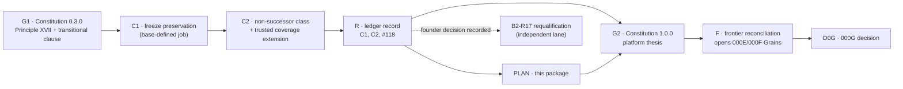

# Governance and CI reconciliation — executable sequence (Phase 0)

**Status:** CANDIDATE PLAN, revised after independent security and testability review (see [INDEPENDENT_REVIEW.md](../../research/wispral-world-class/INDEPENDENT_REVIEW.md)). This document authorizes nothing. It proposes the smallest legitimate sequence by which the founder can make the platform plan executable without weakening, bypassing, disabling, relabeling or suppressing any check. Full evidence: [governance and CI research report](../../research/wispral-world-class/evidence/research-reports/GOVERNANCE_CI_RESEARCH.md), with reproduction scripts and outputs in [evidence/governance/](../../research/wispral-world-class/evidence/governance/trigger_matrix.txt). It refines PR #124's [amendment proposal](WISPRAL_GOVERNANCE_AMENDMENT_PROPOSAL.md) and PR #125's finding M1, and absorbs #126's control work.

Canonical base for every statement: `main` = `edacdf7504302cc91ff7138bc6ac2d391e4df1f4`, unchanged since 2026-09-10 (`RUNTIME_OBSERVED` 2026-11-08). Branch protection: none (classic protection 404, rulesets `[]`). **Missing protection is not permission**; repository governance still binds, and every merge that carries a preserved red check is recorded as an explicit owner act.

---

## 1. Why execution is blocked today

| # | Blocker | Evidence | Classification |
| --- | --- | --- | --- |
| B-1 | **Mission contradiction.** `AGENTS.md` and Constitution 0.2.1 define Wispral as a coding-agent control plane and "not a dictation application"; the anti-roadmap and invariant A12 conflict with the three products; the 000 spec excludes TTS product work | `AGENTS.md:3`; `PROGRAM_ROADMAP.md`; `ARCHITECTURE_INVARIANTS.md` A12; `specs/000-founding-research/spec.md` | Needs a **major** amendment (G2) |
| B-2 | **`verify-b2r16-freeze` fails on every PR and on `main` itself** (`B2R16 actual candidate range scope drift`) | `REPRODUCED` on `edacdf7`, #124, #126, #120; `RUNTIME_OBSERVED` on #120–#125. No path filter (`000b2-public-b2r16-freeze.yml:3-5`); fixed historical base (`verify_b2r16.py:123-130`); requires `completed_recovery_tasks == [B2R13,B2R14,B2R15]` (`:138-140`). Because the range check runs first (`:271-273`), the verifier's later frozen-identity checks are **masked** on every later PR | **Fail-closed over-application** that also hides later checks. Principle XVI covers fail-open defects only |
| B-3 | **Two B2 trusted scope gates permanently lock the frontier files** (`specs/CURRENT.md`, `CURRENT_STATE.md`, …) for every non-B2 PR | `REPRODUCED` harness running main's inline gate programs (matches CI on #126 and #120). After B2 completes, the gate raises `None candidate path scope violation` (`000b2-public-attempt-003-trusted-pr.yml:153-158`) | **Fail-closed over-application**, permanent |
| B-4 | **#118 merged with a red required verifier and no approving review**, recorded nowhere canonical | Run 34416457849; two CodeRabbit `COMMENTED` reviews; `reviewDecision` empty | Governance debt: an undocumented exception |
| B-5 | **Product-code gate** | `CURRENT_STATE.md`; `specs/CURRENT.md` | Legitimate; opened only by 000G |
| B-6 | **No qualifying independent reviewer is configured** | `recovery-v2.md:187`; Constitution XVI.7 | Defined in §5 below; founder must name one |
| B-7 | **Trusted coverage gap:** `research/000b2-entry/**`, `research/000b1/**` and `000b2-entry-*.yml` are guarded only by candidate-controlled `pull_request` workflows, not by a base-defined gate | Security review finding 1/3 (`SOURCE_VERIFIED` path filters) | Strengthening needed in C2 |

## 2. Recommended sequence (lane first)

| Step | Paths | Expected red checks | Status of each red | Review class | Rollback |
| --- | --- | --- | --- | --- | --- |
| **G1** | `CONSTITUTION.md` only | `verify-b2r16-freeze` only | Preserved under G1's transitional clause (§3) — an explicit owner act | Constitution-required | Governed revert |
| **C1** | `.github/workflows/000b2-public-b2r16-freeze.yml`; `research/000b2-public/verify_b2r16_preservation.py`; `research/000b2-public/test_b2r16_preservation.py`; `research/control-repairs/2026-11-*/**` | `verify-b2r16-freeze` (transitional clause); `verify-successor-recovery`, `verify-successor-pr-from-canonical-base` (scope; preserved under XVII only after the counterfactual proof in §4) | Owner act per merge | Constitution-required | Governed revert restores the original workflow; evidence stays |
| **C2** | `.github/workflows/000b2-public-attempt-003-recovery.yml`; `.github/workflows/000b2-public-attempt-003-trusted-pr.yml`; `research/000b2-public/verify_attempt_002_invalidation.py`; `research/control-repairs/2026-11-*/**` | `verify-successor-recovery`, `verify-successor-pr-from-canonical-base` (declared control bytes; XVII counterfactual proof) | Owner act per merge | Constitution-required | Governed revert |
| **R** | `docs/canonical/TRUSTED_CONTROL_REPAIRS.md` (or `CONTROL_CORRECTIONS.md` designated by G1); `AGENTS.md` (reading-order line only) | None | — | Ordinary | Revert |
| **PLAN** | This package (docs and research only) | None after C1 (before C1: `verify-b2r16-freeze`, like every PR) | Must **not** merge before C1 | Ordinary | Revert (no runtime effect) |
| **G2** | `CONSTITUTION.md`, `AGENTS.md`, `ARCHITECTURE_INVARIANTS.md`, `PROGRAM_ROADMAP.md`, `specs/000-founding-research/{spec,plan}.md` | None (`REPRODUCED` trigger set: only the freeze workflow, which C1 corrects) | — | Constitution-required | Governed major revert |
| **F** | `specs/CURRENT.md`, `docs/canonical/CURRENT_STATE.md` (allowlisted sections only, §4.2), `specs/000-founding-research/tasks.md`, new `specs/000E-platform-feasibility/{spec,plan,tasks}.md`, new `specs/000F-provenance-intake/{spec,plan,tasks}.md` | None (passes the non-successor class) | — | Ordinary | Revert |
| **D0G** | 000G closeout + selected Grain specs | Per touched paths; none expected | — | Constitution-required | Revert |

**After C2:** the founder is advised to enable a repository ruleset with exactly one required check — a base-defined aggregator job that always runs and fails if any applicable check is red, absent, skipped, pending or cancelled. Path-filtered checks must not be made *required* individually, or they deadlock as "absent".

**B2 coexistence.** ATTEMPT-003 stays frozen. G1, C1, C2, R, PLAN, G2 and F change no readiness file, task scope, frozen input, `recovery-v2*.md` or B2 evidence; C1/C2 tests prove B2 task and reconciliation classification is unchanged. After C2 and the founder's B2R17 decision in R, PR #120 merges `main`, is fully requalified at its new head (stale evidence does not transfer, `recovery-v2.md:106`), gets a fresh qualifying review, and continues independently. **Only speech-bearing packets wait on B2/B4 or a new speech-evaluation Grain.**

**Rejected alternatives** (research report §7): amendment first (red checks with no authority); one combined amendment (couples CI integrity to the platform pivot; second choice); path-filtering the freeze workflow alone (itself a control change, weaker, leaves the frontier locked); relocating the frontier (path-dodging); waiting for B2 (the lock is permanent).

## 3. Proposed text for G1 (Constitution 0.2.1 → 0.3.0)

> **Principle XVII — Correcting an over-applied control is explicit, narrow and proven.**
>
> **Scope.** This principle applies only to benchmark-lane and governance-scope controls: workflows and verifiers that enforce benchmark task scope, frozen benchmark evidence, or reconciliation scope. It never applies to a control whose purpose is security, consent, tenant isolation, network egress, credential handling, release or signing. Such a control can change only through an ordinary reviewed change that strengthens it, or through Principle XVI.
>
> **Defect.** A control is *over-applied* only when (a) canonical authority text assigns it to a named candidate class, and (b) it is shown, by reproduction on canonical `main` or on a minimal synthetic candidate outside that class, to reject candidates outside that class or `main` itself. Argument alone is not evidence.
>
> **Requirements.** A correction is authorized only through a dedicated control-correction PR that:
> 1. describes the defect, the exact canonical authority base, the exact changed paths, the expected conflict with the pre-correction controls, compatibility, security and privacy impact, and the affected specifications (as Principle XVI.3 requires);
> 2. changes only the exact control paths required;
> 3. proves that detection on the authorized class is preserved in full: identical verdicts on an in-class corpus that includes every previously rejected malformed candidate, plus at least one negative fixture for every rejecting branch of the corrected control, all executed from trusted (base-pinned, hash-verified, isolated-interpreter) code;
> 4. does not broaden any task, reconciliation, execution, decode, scoring, comparative-claim, product or completion authority; a newly accepted candidate class carries no execution authority;
> 5. preserves each pre-correction failure as conflict evidence, never relabeled, suppressed or rerun to green, and proves it is caused **solely** by the declared control-byte change through a counterfactual run of the same candidate with those control bytes reverted, in which that failure disappears and no other check changes;
> 6. satisfies every other exact-head gate required by canonical authority and applicable to the candidate; a required gate that is absent, skipped, pending, cancelled or failed is not satisfied, except the preserved failures of item 5;
> 7. receives a qualifying independent review (Governance item 7) of the exact final range;
> 8. uses a guarded normal merge bound to the reviewed head, recorded as an explicit owner act;
> 9. is exercised against the exact canonical merge by a deterministic verifier or a dispatched canonical workflow; and
> 10. is recorded by a separate canonical reconciliation before dependent work relies on it.
>
> This authority must not substitute for an ordinary required gate. If preservation, the counterfactual proof or strict non-broadening cannot be demonstrated, the project remains blocked.
>
> **Transitional clause.** The failure `B2R16_ATTEMPT_003_FREEZE=FAIL: B2R16 actual candidate range scope drift`, reproduced on canonical `edacdf7504302cc91ff7138bc6ac2d391e4df1f4`, may be preserved as evidence **only on this amendment PR and on correction C1**, and only when: (i) the PR changes no path under `.github/**` other than C1's declared freeze workflow and none of the 16 frozen B2R16 paths; (ii) every other applicable check concludes successfully; and (iii) the B2R16 preservation checker, run from the copy at `TheHalfMoon/Wispral@a97d596bfc9a027bc6c71747b11d94de14f3e838` with its SHA-256 verified and an isolated interpreter, reports `B2R16_FROZEN_OBJECT_PRESERVATION=PASS` on that PR's head, with the run recorded. This clause expires when C1 merges.
>
> **Governance item 7 (new) — Qualifying independent review.** A review satisfies "independent" only when the reviewer did not author the change and is one of: (a) the repository owner personally reviewing the exact range; (b) a human the owner names for that PR; or (c) an automated reviewer of a different model vendor or lineage than the author, with its model identity, prompt and output recorded. Local classifiers and same-lineage agents may assist but never qualify. Reviews required by Principles XVI and XVII, constitutional amendments and benchmark-lane merges need a qualifying review; ordinary planning and documentation PRs need a fresh-context review plus the owner's merge approval.
>
> **Founder decision recorded in this amendment:** non-B2 governance PRs may edit only the allowlisted sections of `specs/CURRENT.md` and `docs/canonical/CURRENT_STATE.md` defined in correction C2, both while ATTEMPT-003 is active and after it completes.

## 4. Corrections C1 and C2 — required content

### 4.1 C1 — freeze preservation from a base-defined job

1. Keep `verify_b2r16.py` and all frozen payloads unchanged. Verify the 16 frozen path identities against canonical merge `885307429ec8b1aa0fe173169a8c2918714c06b0`; run the unchanged verifier at qualified head `ac9f7ce993aec33e6c6436cce4efd85394a97f35` and preserve its PASS output; reject byte, deletion, mode and symlink tampering, forged checker or test scripts, and import shadowing (#126's seven-group suite).
2. **Run the preservation checker from a base-defined `pull_request_target` job** with `python -I`, reading the candidate only as data. Candidate-controlled workflows are no longer the trust root for the freeze.
3. Fixes to #126: replace the test pin on `f36338138f4b…` (reachable only from unmerged branches) with a commit reachable from `main` or a synthetic fixture; add a `workflow_dispatch` post-merge exercise (the workflow has no `push` trigger); describe C1 as a Principle XVII correction.
4. Counterfactual evidence for each preserved red (XVII.5).

### 4.2 C2 — non-successor class with exact section rules

1. **Recognized only when all hold:** the readiness JSON blob equals the authority base; no changed path lies under `.github/**`, `research/000b1/**`, `research/000b2-entry/**`, `research/000b2-public/**`, `specs/000B*/**` or `fixtures/**`; and every frontier-file edit is within the allowlist below.
2. **Allowlisted sections** (a section runs from its `## ` heading line to the line before the next `## ` heading or end of file):
   - `docs/canonical/CURRENT_STATE.md`: `## Current product thesis`, `## Current architecture posture`, `## Explicit non-claims`, `## Product-code gate`.
   - `specs/CURRENT.md`: `## Remaining founding children`, `## Product-code gate`.
   - Either file: new sections appended **after the last existing section** whose heading begins `## Platform frontier`.
   - Everything else, including the title, the metadata block before the first `## ` heading, every other section and the order of all existing headings, must be byte-identical to the authority base. Text is NFC-normalized before comparison; duplicate or look-alike headings (Unicode confusables) are rejected.
3. **B2 markers occur exactly once and only inside B2-owned sections** (for example `Active successor recovery unit`, `ATTEMPT-003 primary decode entry open`, `production_stt_selected`, `product_code_authorized`); a candidate adding a marker anywhere else fails. This closes the marker-injection path in `verify_attempt_002_invalidation.py:694-711`.
4. **Trusted coverage extension:** the base-defined gate also runs for `research/000b2-entry/**`, `research/000b1/**` and `.github/workflows/000b2-entry-*.yml`, so their changes are no longer guarded only by candidate-controlled workflows.
5. **Tests:** PR #120 still passes both gates; F's literal planned diff passes (positive fixture); F-like candidates plus any B2 path, readiness change, `.github/**` change, non-allowlisted section edit, reordered heading, confusable heading, duplicated heading or injected B2 marker fail; extra-path, missing-path and deletion task candidates still fail; terminal-state fixture (`active_recovery_unit: null`) accepts a non-successor candidate and rejects a B2-path candidate. All executed from base-pinned code.

## 5. Blocking-gate register (summary)

The full register with authority lines, failure text, reproduction commands, tests and rollback is in the [research report §8](../../research/wispral-world-class/evidence/research-reports/GOVERNANCE_CI_RESEARCH.md#8-task-7-blocking-gate-register-recommended-sequence).

| Gate | Authority | Failure | Applies? | Correction | Position |
| --- | --- | --- | --- | --- | --- |
| GATE-1 `verify-b2r16-freeze` | `000b2-public-b2r16-freeze.yml:3-5`; `verify_b2r16.py:123-140,271-273` | `B2R16 actual candidate range scope drift` | No (B2R16-task verifier applied to everything; masks later checks) | G1 transitional clause, then C1 | G1, C1 → fixed by C1 |
| GATE-2 `verify-successor-recovery` | `000b2-public-attempt-003-recovery.yml:133-162` | `B2R17 task-candidate path scope violation` | On C1/C2: yes (preserved with counterfactual). On F before C2: no | C2 non-successor class | Preserved on C1/C2; passes on F |
| GATE-3 `verify-successor-pr-from-canonical-base` | `000b2-public-attempt-003-trusted-pr.yml:83-160` | `B2R17 candidate path scope violation` / immutable control changed | Same | Same | Same |
| GATE-4 common verifier | `verify_attempt_002_invalidation.py:370-423,694-711` | exact canonical task path set | Same | Same + marker uniqueness | C2 |
| GATE-5 qualifying review | Proposed Governance item 7 | — | G1, C1, C2, G2, D0G, B2-R17 | **Founder names reviewers** | Before each of those merges |
| GATE-6 guarded merge + exercise | XVI.8–9 / XVII.8–9 | — | C1, C2 | `workflow_dispatch` on merge SHA | After C1 and C2 |
| GATE-7 product-code gate | `CURRENT_STATE.md`; `specs/CURRENT.md` | — | Any product code | G2 → F → D0G | After F |
| GATE-8 #118 record | Constitution Governance 2 (no hidden exceptions) | run 34416457849 | Debt | R records it as an exception (§7.5) | R |

## 6. What this planning PR is and is not

- Research and planning only: `docs/strategy/`, `docs/design/`, `docs/engineering/`, `docs/adr/`, `research/rea/`, `research/reviews/`, `research/wispral-world-class/`. It carries PRs #123, #124 and #125 by merge ancestry.
- **Before C1 merges**, its only red check is `verify-b2r16-freeze`, the same failure `main` has; it is reported as **FAIL**. **After C1 and C2**, no red check is expected. It must not merge before C1.
- It edits no constitution, `AGENTS.md`, canonical document, `specs/`, workflow, trusted verifier or B2 artifact. Proposed amendment text appears only inside this document.

## 7. Founder-only decisions (in order)

1. Ratify G1 as drafted or revised, including the transitional clause and Governance item 7.
2. Name the qualifying reviewers for G1, C1, C2, G2, D0G and B2-R17. Zero-cost options: the founder's own review of the exact range, or a different-vendor model reviewer the founder already has access to, with its identity recorded.
3. Authorize each guarded merge (recorded as owner acts where a red is preserved); record live branch settings at merge time.
4. After C2: decide whether to enable the single-aggregator ruleset.
5. **#118:** decide on fresh evidence, not by relabeling. Recommended evidence: run the trusted B2R16 preservation checker on the #118 merge and obtain a qualifying retrospective review of #118's range. R then records #118 as "merged with a red required verifier and no approving review — exception recorded on [date] with this evidence", and the founder states whether the B2R17 frontier stands.
6. Ratify G2 after reviewing this plan.
7. Open PRs: #120 requalify after C2; #121 independent; #123–#125 carried by PLAN (close as superseded after PLAN merges); #126 superseded by C1.

## 8. What the engineering agent can do once authorized

Draft G1's PR text; prepare C1 and C2 with all fixtures and counterfactual runs; run every local positive and negative test and the gate harness at the exact heads; open draft PRs with full XVI.3-style descriptions; capture run IDs; dispatch post-merge exercises with permission; draft R, G2 and F; prepare #120's requalification. None of this starts without the founder's go-ahead for that specific PR.
