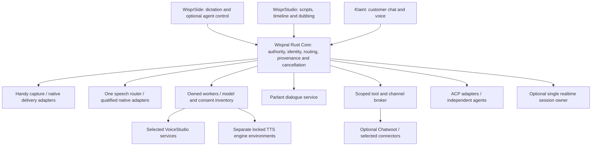

# Wispral platform architecture replan

Status: **PROPOSED — RESEARCH ONLY**, 2026-10-21. This plan follows the [source studies](../../research/rea/2026-10-21/README.md) and [72-mechanism transplant matrix](../../research/rea/2026-10-21/SOURCE_TRANSPLANT_MATRIX.md). It does not replace the active constitution, canonical architecture, specification frontier or 000G gate. Final founder names: **Wispral / WisprStudio / WisprSide / Klaint**.

Wispral should be one voice platform with a shared Rust authority and resource core. WisprSide provides cross-application dictation and optional developer-agent control. WisprStudio provides generation, timeline/editing, long-form rendering and dubbing. Klaint provides bounded customer dialogue, tools, channels and human handoff. Each surface can ship on its own qualified capability manifest; no user must install every engine or open an account to use the local core.

## Donor-led structure

| Layer | Proposed boundary | Why this boundary follows source evidence |
| --- | --- | --- |
| Rust Core | Session/epoch events, deterministic policy, provenance, routing, process ownership, resource leases and metadata journal | Adapt Sentrdel/Ninerr/Ascout/Orcel narrow mechanisms. Their complete applications would duplicate responsibility and import large unrelated closures |
| Native capture and text delivery | Handy recorder/keys packages; adapted Handy transaction/coordinator; selected OpenWhispr target/failure helpers | Rust aligns with Core; C/OS helpers remain narrow. Remove focus fallback, Tauri manager coupling and insecure default screenshot behavior |
| Speech router | A single versioned backend interface, one default per qualified configuration | No measured STT winner. Preserve frozen B2 while qualifying exact native/model identities separately |
| Model execution | Supervised processes with locked environments and exact artifacts | VoiceStudio, Chatterbox, Qwen and CosyVoice have conflicting transformers/torch constraints. Do not combine one environment or rewrite the engines in Rust |
| Studio services | Selective VoiceStudio fit/render/resume/project/dubbing mechanisms; one project store/timeline | Voicebox is a narrower alternative, not a second queue/database/UI alongside the lead |
| Klaint dialogue | Parlant package/service with bounded NLP and tool interfaces | Guidelines are probabilistic behavior, not authorization. Preserve engine/package boundary rather than copy one coupled engine.py |
| Inbox/connectors | Optional Chatwoot service; selected Botpress connector/HITL schemas | Chatwoot has a real Rails inbox/ownership model. Botpress public SDK does not reproduce Botpress Cloud runtime |
| Realtime media | Optional Pipecat worker for local configurable pipeline; LiveKit alternative when WebRTC/SIP topology requires it | One turn controller per session. Push-to-talk must not depend on either full framework |
| Coding agents | ACP Rust SDK; external Codex/Claude adapters through qualified protocol; Gemini/PTY only after separate trials | Preserve agent portability without making a proprietary subscription or copied agent runtime compulsory |



Arrows denote bounded requests, not unrestricted authority or shared credentials. Proposed paths live in the transplant matrix; diagrams do not create implementation scope.

## Authority and data contracts

Core admits immutable facts separately: raw speech, tentative/final hypotheses, user corrections, normalized text, entity bindings, interpreted intent, target/context snapshot, policy decision, dispatch and observed outcome. A user-facing polished sentence must not erase the raw hypothesis or claim every append-only committed_text field is authoritative: transcribe-cpp's backend semantics differ. Keep provider raw text and committed/draft events distinct until each adapter qualifies them.

Every request/event needs a version, request/session/turn ID, monotonically increasing session epoch, sequence, trusted source identity, event type and payload bound. Customer workloads additionally bind tenant/account/channel; desktop delivery binds OS session plus captured target identity, process incarnation and context-consent epoch. A provider/model artifact digest, configuration digest and relevant policy/consent version invalidate stale work. Timestamps support diagnostics, not authority ordering. IDs supplied in customer text cannot select tenant or credentials.

Proposed envelope shape, to be refined into a bounded contract Grain:

```json
{
  "schema_version": 1,
  "request_id": "synthetic-request",
  "session_id": "synthetic-session",
  "epoch": 7,
  "sequence": 12,
  "principal_scope": "trusted-desktop-or-tenant-reference",
  "source_digest": "sha256:artifact-or-content-identity",
  "policy_version": "qualified-policy-identity",
  "consent_epoch": 3,
  "event": "TranscriptFinal",
  "payload": {}
}
```

These are illustrative fields, not an approved wire schema. Cap frame/string/depth/event rate before decoding; do not log raw media or secrets. Use bounded stdio framing for local workers where possible. No unauthenticated listening local HTTP service as an accidental default. A service topology requiring HTTP must qualify authentication, origin binding, resource limits and tenant scope.

## Cancellation, playback and side effects

Model independent lifetimes for capture, ASR, dialogue, TTS, audible playback, tool dispatch, render and text insertion. Request cancellation advances the session epoch and prevents stale output from becoming active. States must distinguish request sent, acknowledged, observed stopped, completed-before-cancel, failed and stopped-unconfirmed. Do not release worker/model memory leases on acknowledgement alone.

Stop local playback immediately using the qualified audio path. Send the provider's correct request/session cancel and, where needed, truncate unheard audio context. Observe worker exit/idle or native completion; escalate within a preregistered deadline to terminate only the owned process tree. Termination must not target a reused PID. Interrupted action completion remains factual: a committed ticket/refund or partially typed string cannot be undone by deleting an event. Represent unknown external outcome and reconcile through a read/idempotency key rather than blindly retry.

One realtime worker owns a session's turn policy, but Core retains action authority and epoch gating. Pipecat CancelFrame, LiveKit interrupt and Parlant cancellation are adapter observations, not universal external rollback. Deepgram eager endpoint signals may trigger speculative reversible work only; they do not authorize customer mutation.

## Text delivery and contextual rewriting

At activation, capture a bounded target token. Revalidate before every delivery attempt: OS session, target liveness/process incarnation, allowed field/window, foreground/focus state and policy epoch. If identity is unreadable or restoration fails, return a visible blocked result and retain editable text. Do not inherit OpenWhispr's fallback to the current foreground. A clipboard reader receipt is evidence of a reader, not proof of intended-field insertion.

Use one transaction with explicit outcomes: refused, posted-unconfirmed, confirmed-by-qualified-mechanism, partially-posted, failed. Never auto-retry partial delivery. Restore clipboard only if the transaction still owns the clipboard marker/version; preserve a user's intervening clipboard change. Browser/editor/terminal/password/elevated windows require separate fixtures and capability restrictions. Sending Enter/submit is a separate action, never implied by paste success.

App context is optional and narrowly scoped: user-selected text/application metadata first; screenshot acquisition requires distinct explicit consent and visibility. Context is untrusted evidence, never system policy. Sensitive fields/apps default to no capture. FreeFlow's enabled screenshot fallback and remote context payload are not inherited. Keep raw text, edited suggestion and final accepted text separate; numbers, negation, names and code identifiers need meaning-distortion checks and reversible correction.

## Workers, resource scheduling and artifact inventory

Share one artifact inventory and resource lease coordinator across surfaces. Record engine source/native library/model/tokenizer/voice digests, runtime/provider versions, language support, resource profile, terms/card version and consent applicability. Cache keys include input/config/artifact/consent epoch and do not cross tenants. Source rights are founder-confirmed; model/voice rights remain distinct.

Use a separate locked environment per engine family. VoiceStudio requests transformers >=5.10.0, Chatterbox ==5.2.0, Qwen3-TTS ==4.57.3 and CosyVoice ==4.51.3 at the inspected pins, with incompatible torch/pyannote combinations. Admit only the selected engine environments, not every donor extra. Pin mutable git dependencies such as resemble-perth before execution. No auto-download during offline mode.

Scheduling starts with one active bounded job per qualified engine/accelerator lease. Later concurrency requires measured RSS/VRAM and cancellation behavior; queue length and per-tenant work/audio-duration limits are explicit. OOM/crash quarantines the worker and marks its result incomplete. Restart resumes only digest-valid completed segments. Revoked voice consent invalidates queued cloning and future cache reads. A recording/tracing default in a donor is not the platform privacy policy.

## Klaint tools, tenancy and human ownership

Parlant prepares guidelines/context, infers tools and calls ToolService. Inject both a restrictive Plan and brokered ToolService: pre-tool filtering alone cannot guard an alternate invocation path. Workers receive no broad CRM credentials. Resolve tenant/customer/tool capability from authenticated server-side context; bind arguments, policy version, target resource and action class before dispatch. External responses are untrusted input.

Adapt Chatwoot account-scoped assignment and ownership transitions. Human takeover advances the AI epoch and stops future AI sends; bot handoff source without locking is not enough for a race-safe bridge. Store an outcome ledger per idempotency key for mutating connectors. Authenticate webhooks over exact bytes, reject nonfinite/stale/future timestamps within a defined skew, and maintain replay protection. Botpress connector schemas reduce API work; they do not replace tenant authorization or vendor entitlement.

Ship synthetic text dialogue and fake tools before voice or live CRM actions. Telephony is a later optional boundary with recording/retention disclosure, regional routing, verified caller/context rules, transfer failure recovery and an authorized test number. Tenant isolation cannot be inferred from a local desktop process model.

## Persistence, packaging and observability

Use a metadata event journal and product-specific stores behind versioned migrations. Reuse the lead donor's project/resume formats through an adapter before inventing a new project engine. Do not run two Studio databases or duplicate Chatwoot conversation ownership. Human-readable exports preserve input/source/translation/output provenance; media remains outside metadata logs and follows explicit retention.

Initial delivery is a qualified Windows local path with text/keyboard fallback. Keep Core CLI usable for diagnostics and automation; add one optional desktop surface using Handy/Tauri seams only after governance and native tests. macOS accessibility/paste adapters and Linux portals/Wayland require separate platform qualification. Mobile keyboards, background capture and cross-device sync remain distant, separately scoped work. A donor platform badge is not Wispral support.

Release packaging must bind the full binary/native/model closure and notices, disable unselected network/telemetry/download defaults, and verify clean install/update/rollback. No runtime implementation, dependency installation, cloud inference or signed package was produced by this mission. See [master plan](WISPRAL_MASTER_PLAN_REBUILT.md), [work packets](WISPRAL_COPY_FIRST_WORK_PACKETS.md) and [governance proposal](WISPRAL_GOVERNANCE_AMENDMENT_PROPOSAL.md).
