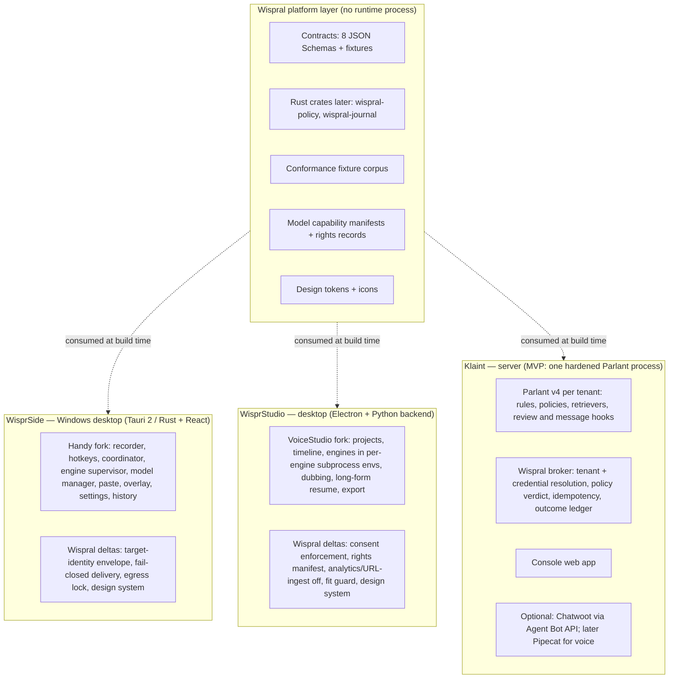
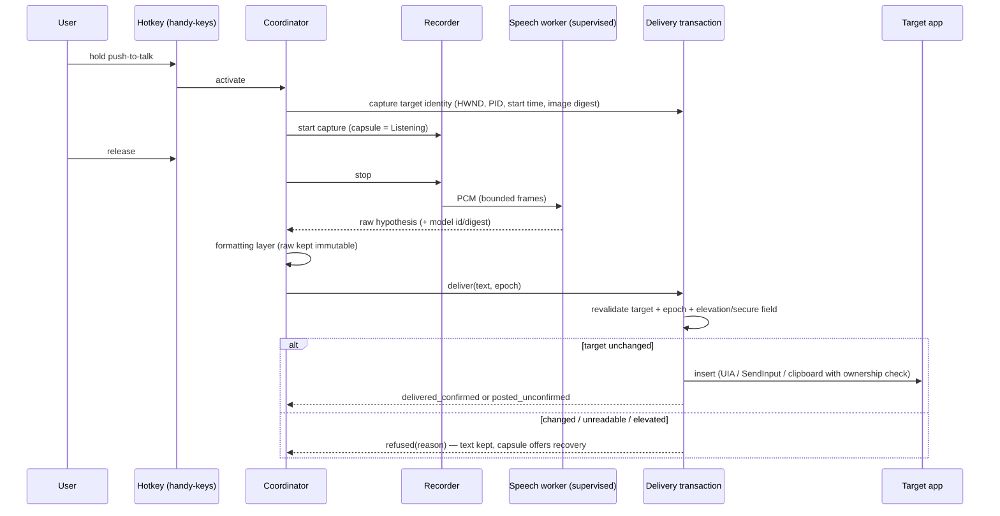

# Wispral product architecture

**Status:** CANDIDATE ARCHITECTURE — not ratified; it does not replace the canonical [architecture invariants](../canonical/ARCHITECTURE_INVARIANTS.md) until the amendment in [WISPRAL_GOVERNANCE_RECONCILIATION.md](WISPRAL_GOVERNANCE_RECONCILIATION.md) is adopted. Part of the [World-Class Master Plan](WISPRAL_WORLD_CLASS_MASTER_PLAN.md).
**Supersedes for planning purposes:** PR #124's [architecture replan](WISPRAL_PLATFORM_ARCHITECTURE_REPLAN.md), which remains the detailed evidence-linked predecessor. Where the two differ, this document records the change and the reason in the [decision ledger](../../research/wispral-world-class/DECISION_LEDGER.md).

---

## 1. Shape of the system

Wispral is **three independent products plus a thin shared layer**. There is no central Wispral daemon. Each product owns its own processes, lifecycle, storage and side effects, and can be installed alone.

**Why no central runtime.** A single-user desktop app and a multi-tenant server have different identity, scaling, deployment and failure models. A shared daemon would add an IPC hop and a trust boundary to every call without adding authority, and would force co-installation. The shared value lies in *agreeing on semantics* (envelope, cancellation states, consent, verdicts, provenance), which contracts, a library and fixtures deliver. This follows Opus review S2 (PR #125) and was confirmed by the Core audit ([decision D-03](../../research/wispral-world-class/DECISION_LEDGER.md)).

## 2. One owner per responsibility

Every lifecycle, inventory, identity and side effect has exactly one owner per runtime. Owners come from the donor wherever the donor already has a working mechanism.

| Responsibility | WisprSide | WisprStudio | Klaint | Platform role |
| --- | --- | --- | --- | --- |
| Process lifecycle | Handy engine supervisor (fork) | VoiceStudio contained subprocess + subprocess backend (fork) | Service host (systemd/container); Pipecat owns only its session tasks | Cancellation contract + fixtures |
| Cancellation | Coordinator (single owner); maps to contract states | Job registry (single owner); mandatory escalation deadline → kill exact instance → observed exit | Klaint process supervisor (single owner); the broker reports effect state, Pipecat only reports frame cancellation | `cancellation.schema.json` + transition table |
| Model inventory | Handy model manager + manifest delta | VoiceStudio model acceptance (Studio implementation of the manifest) | Tenant config of provider/model | `model_manifest.schema.json` |
| Voice consent ledger | n/a | Studio consent store (extends `record_consent`) | n/a (brand voices later follow the same contract) | `consent_record.schema.json` |
| Tenant identity | n/a (local OS user) | n/a (local OS user) | Authenticated service context, one instance per tenant first | Envelope `principal_scope` |
| External side effect | Delivery transaction; outcome written to history as a `delivery_outcome` (not an `effect_intent`: most targets have no read-back probe) | Export commit (atomic write) as an `effect_intent` | Broker: sole executor; `effect_intent` keyed by H(tenant, conversation, tool, canonical args) + outcome ledger | `delivery_outcome`, `effect_intent`, `policy_verdict` |
| Inference server (Klaint) | — | — | One owned local inference server (llama.cpp-compatible) or an explicitly configured tenant provider; per-tenant keys; no cross-tenant prefix cache | Manifest row per model |
| Gateway and shared Chatwoot (Klaint, tier S) | — | — | Gateway maps tenant to process and is the isolation boundary; one shared Chatwoot with one account and bot per tenant, both owned components with routing tests | Envelope `principal_scope` |
| Rewrite LLM (WisprSide, tier S) | Bundled llama.cpp-compatible server under the engine supervisor with a manifest row, or a user-owned external server labelled and excluded from offline claims | — | — | Manifest + p95 latency gate |
| Runtime environments (Studio) | — | Pinned, digest-checked runtime bundles (CPU variant included) or one explicit user-started download with declared hosts; at most two engine environments in the MVP | — | Runtime manifest |
| Network egress | Capability manifest + egress lock in settings | Same; analytics and URL ingest compiled off or default-off | Declared connector hosts per tenant | WB-EGRESS |
| Updates | Tauri updater (signed), opt-in check | electron-updater (signed), opt-in check | Operator-managed images | Signing policy |
| Telemetry | None | None (donor analytics disabled) | Operational metrics only, content-free, tenant-controlled | Privacy contract |

## 3. Wispral Core: contracts, library, fixtures

| Artifact | Content | Status |
| --- | --- | --- |
| [Contracts](../engineering/contracts/README.md) | Envelope (typed payloads per event), cancellation, model manifest, consent record, policy verdict, provenance event, delivery outcome, effect intent — JSON Schema 2020-12, canonicalized with RFC 8785, NFC and documented path rules | Drafted; `PASS` 125 cases, 10 sequences, 4 cross-record bundles (`REPRODUCED`) |
| `wispral-policy` crate | Monotonic narrowing lattice and bounded JSON input, adapted from Sentrdel | Deferred until a second Rust consumer exists (CORE-R1); Klaint's policy is a Python module inside its broker (KT-03) |
| `wispral-journal` crate | orcel-journal copied unchanged | Deferred with CORE-R1; Klaint uses a database ledger with the same state table |
| Fixture corpus | Shape, runtime, sequence and bundle fixtures; product behavior fixtures live in each product's packets | Packet CORE-01 |
| Manifests | One manifest row per model bundle; rights recorded separately for code and weights; no pickle or remote code for admitted models | Packets CORE-01, ST-D02 |

The platform layer is versioned with semantic versioning. Products pin a contract version. A contract change that tightens an invariant is a major version and needs migration notes.

## 4. Data flows

### 4.1 WisprSide dictation

### 4.2 WisprStudio render

Script blocks → job specs (engine, model revision, voice, consent epoch) → job registry → per-engine subprocess → segment files → journaled assembly → atomic export + provenance sidecar. Before each segment the job re-checks consent epoch and model identity. A crash leaves the journal; resume re-verifies identities before continuing.

### 4.3 Klaint conversation turn

Channel message → the tenant's Parlant process → rule and policy matching → tool inference → `on_reviewing_tool_calls` gate (BAIL anything the broker pre-denies) → **broker as the sole executor of consequential tools**: it resolves tenant and credentials from authenticated context, evaluates the deterministic policy (verdict), records an `effect_intent` before dispatch, assigns an idempotency key, calls the connector and records the outcome → reply generation → commitment guard in `on_message_generated` (BLOCK mode: a commitment without a committed receipt is replaced by an approved template or a handoff) → channel. Takeover advances the ownership epoch; an in-flight AI message with a stale epoch is discarded. Parlant v4 has no tenant concept and ships an unauthenticated local tool server on port 8818 that trusts caller-supplied customer ids, so that server is disabled in every Klaint process; consequential and data-reading tools exist only in the in-process ToolService behind the broker.

## 5. Deployment topology

| Product | First release | Later |
| --- | --- | --- |
| WisprSide | Per-user Windows install (signed installer), local models in the user profile, no server | macOS (notarized), Linux (X11 first, Wayland via portals), managed enterprise deployment |
| WisprStudio | Desktop install; Python engine environments created by the app's existing per-engine mechanism; optional GPU | Shared render workers on a LAN; local authenticated API |
| Klaint | MVP: one hardened Parlant process (production mode, loopback only, dashboard and plugin tool server off), broker, local inference server, database, optional Chatwoot; webhooks acknowledged immediately and processed from a queue | Tier S: gateway + one Parlant process per tenant (plugin tool server off in every process) + shared Chatwoot (one account and bot per tenant); shared multi-tenant Parlant only after isolation fixtures pass |

## 6. Failure behavior

| Failure | Behavior |
| --- | --- |
| Speech model missing or failed | Capsule error with "Choose model"; no network fallback |
| Optional LLM not configured or unreachable | `ProviderUnavailable`; raw text delivered or kept; never a silent cloud call |
| Target identity unreadable (UIA timeout > 100 ms, hosted UWP app, hung target) | `identity_unreadable` refusal; text kept |
| Two products compete for CPU/RAM on HW-A | Studio workers default to cores−2 threads at low priority; model loads check free memory and refuse instead of paging |
| Target changed before delivery | Refusal with recovery; nothing inserted elsewhere |
| Engine subprocess crash or OOM | Job marked failed with the reason; completed segments kept; lease released only on observed exit |
| Consent revoked mid-job | Job blocked at the next segment boundary; already-rendered segments quarantined, not exported |
| Connector timeout after send | Outcome `unknown`; reconcile by read-back with the idempotency key; never blind retry |
| LLM provider outage (Klaint) | Handoff to human with a visible reason; no provider switch unless the tenant configured an explicit secondary |
| Policy engine error | `UNDECIDABLE` ⇒ treated as DENY |

## 7. Technology and language boundaries

- **Rust** owns WisprSide's runtime (inherited from Handy, Tauri 2) and the `wispral-policy` crate (Constitution X).
- **Python** owns model inference in WisprStudio (inherited per-engine environments, capped at two in the MVP) and the Klaint service (Parlant, broker, later Pipecat). This is a bounded, justified boundary, not a rewrite target.
- **TypeScript/React** owns the donors' renderers and the Klaint console.
- No cross-language RPC hop exists on a hot path that does not already exist in a donor.

## 8. What changed versus PR #124's architecture

| Topic | PR #124 (after Opus repair) | This plan | Reason |
| --- | --- | --- | --- |
| Core shape | Contracts + small library + fixtures | Same, plus **executable** schemas and fixtures now drafted and passing | Turns the proposal into a testable interface |
| Klaint tenancy | Tenant binding in a shared service | **One service instance per tenant first**; shared multi-tenancy only after isolation fixtures pass | Smallest defensible isolation for an MVP; avoids building tenancy into Parlant prematurely |
| Klaint MVP | Shared service with tenant binding | **One hardened process**, broker as sole executor, plugin tool server off, per-call token bound to the session | Architecture and security reviews (2026-11-08): the plugin server trusts caller-supplied customer ids |
| Shared Rust crates | Rust policy crate + binding | Deferred until a second Rust consumer exists | Copy-first review: no MVP user |
| Text delivery record | Effect intent | `delivery_outcome` in history | Architecture review: no read-back probe for most targets |
| Design system | Absent | Shared tokens, components and review method across all three products | Founder requirement; design is first-class |
| Model routing | Contract only | Capability manifest schema + routing rules tied to measured cells and the CPU-only reference machine | Routing must be testable and honest about hardware |
| Governance dependency | Founding-chain re-scope proposal | Executable reconciliation sequence with per-gate evidence | Unblocks execution legitimately |
