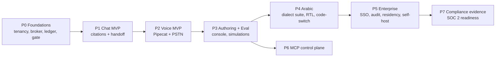

# KLAINT_COMPETITIVE_ROADMAP.md

**As of:** 2026-11-18 · **Starting point:** Wispral is specification-only (`CURRENT_STATE.md:33-34`); Klaint has no product code.
**All effort figures are estimates** (engineer-weeks, EW) and must be re-baselined after the first sprint. Ranges reflect uncertainty, not precision.

> **Canonical-vs-proposal notice.** The ratified baseline is a **Python broker package (BN-02, ~800-1,500 LOC estimate) in a separate process from Parlant, with a DB-table ledger and Rust crates deferred** (`docs/strategy/WISPRAL_COPY_FIRST_STRATEGY.md:50-58,71`; `WISPRAL_MASTER_PLAN_FINAL.md:212,309`). The Rust broker in earlier drafts of this roadmap is an **unratified proposal**. P0 below is written to the canonical baseline; `ARCHITECTURE_RECONCILIATION.md` records the comparison and what would make Rust ratifiable.

---

## 1. The only honest headline

Klaint cannot "beat" Lorikeet, Decagon, or Parloa today. It can **compete credibly in a defined wedge** - Arabic-first, self-hosted, verifiable action authority - if it ships the contracts in `KLAINT_TARGET_ARCHITECTURE.md` before it ships features.

Anything else is a slide deck.

---

## 2. Strategic sequencing

**Why this order:** the broker/ledger/gate are worthless if retrofitted; chat is the cheapest way to exercise them; voice is the differentiator but multiplies failure modes; authoring and evaluation are table stakes; Arabic and enterprise unlock the wedge.

---

## 3. Phase plan

### P0 — Foundations and hard gates (3-4 weeks, 2-3 engineers)

| Workstream | Deliverable | EW (est.) |
|---|---|---|
| Repo + contracts | Monorepo, CI, ADRs, threat model, egress manifest schema | 1-2 |
| Tenancy | Tenant/workspace/agent/channel schema, RLS, leak test harness | 2-3 |
| Broker | **Python package** (canonical BN-02): Ed25519 mint/verify, nonce ledger, policy snapshots + DB ledger table; separate process from Parlant | 3-4 (estimate) |
| Ledger | Event-sourced intents/authorizations/effects, idempotency keys | 2-3 |
| Tool registry | Schema + side-effect class + egress + compensation declarations | 1-2 |
| Gate skeleton | Deterministic checks, fail-closed, action-claim consistency | 2-3 |
| Test harness | C1-C4, C9-C10 automated | 1-2 |

**Exit gates (blocking):**

- G1: forged/replayed/substituted capability produces zero data and zero effects.
- G2: tenant leak suite is green on every query path.
- G3: undeclared egress fails startup and CI.
- G4: every tool call appears in the ledger with a trace id.

**Do not start P1 until G1-G4 pass.** This is the KT-01 lesson.

---

### P1 — Chat MVP with citations and handoff (5-7 weeks, 3-4 engineers)

| Workstream | Deliverable | EW |
|---|---|---|
| Channel gateway | Web chat WebSocket/SSE, session cookies, rate limits | 2-3 |
| Orchestrator | Session state, flow graph, prompt assembly, agent version pinning | 4-6 |
| Retrieval | Ingest, chunking, hybrid search, ACL pre-filter, citations | 3-5 |
| Gate | `GUARDED` profile, grounding checks, PII, brand | 2-3 |
| Handoff | Chatwoot core integration, ownership epochs, handoff packet | 3-4 |
| Console v0 | Agent config, KB upload, conversation traces | 4-6 |
| Eval v0 | 30 scripted scenarios + adversarial suite | 2-3 |

**Exit gates:**

- G5: every factual answer has a resolving citation; invalid citation blocks release.
- G6: human takeover mid-generation never produces a double reply (100% scripted cases).
- G7: adversarial prompt-injection suite cannot produce an unauthorized action (0 successes).
- G8: p95 chat latency < 3 s with gate enabled (non-voice).

**Demo that matters:** a support conversation in Arabic and English where the agent refunds the *right* order, shows a receipt, cites policy, and hands off cleanly — and a red-team attempt that fails visibly.

---

### P2 — Voice MVP (6-8 weeks, 3-4 engineers + voice specialist)

| Workstream | Deliverable | EW |
|---|---|---|
| Pipecat pipeline | Transport, VAD, turn detection, barge-in, interruption recovery | 5-7 |
| STT/TTS adapters | Provider abstraction, language routing, failover | 3-5 |
| Telephony | LiveKit SIP or Twilio, number provisioning, transfer, DTMF | 3-4 |
| Voice gate | Sentence-committed gating, barge-in-safe TTS | 2-3 |
| Voice eval | Recorded scenarios, barge-in tests, dialect smoke | 2-3 |
| Cost/latency telemetry | Per-call cost attribution, p50/p95/p99 | 1-2 |

**Exit gates:**

- G9: barge-in stops TTS within 250 ms; no lost context.
- G10: p95 end-to-end < 2.5 s on the reference network.
- G11: `REGULATED` voice profile never releases ungated text.
- G12: cost per 3-min call within the modeled band ($0.11-0.27 infra).

---

### P3 — Authoring, simulations, and evaluation (5-7 weeks, 3-4 engineers)

| Workstream | Deliverable | EW |
|---|---|---|
| Console v1 | Flow editor, policy editor, draft/publish/diff, four-eyes approval | 6-8 |
| Simulations | Scenario generation from transcripts, mocked tools, batch runs, diffs | 5-7 |
| Eval engine | Deterministic rules + LLM judge + human review queue | 4-6 |
| CI gate | Block release on failing suites | 2-3 |
| Analytics | Resolution, escalation, gate blocks, citation coverage, cost | 3-4 |

**Exit gates:**

- G13: a release cannot publish if the regression suite fails.
- G14: simulation tool mocks can branch on inputs (fixing Lorikeet's published limitation).
- G15: evaluation shows per-scenario trace with gate + tool receipts.

---

### P4 — Arabic and dialect excellence (6-10 weeks, 2-3 engineers + linguists)

| Workstream | Deliverable | EW |
|---|---|---|
| Benchmark | MSA + Gulf + Egyptian + Levantine + Arabizi + code-switch; audio + text | 6-9 |
| STT/TTS bake-off | Provider matrix, dialect WER, naturalness MOS | 3-5 |
| Prompt/lexicon | Dialect-aware style, honorifics, numbers, dates, RTL | 3-5 |
| Console/UI | Full RTL, Arabic search, Arabic citations | 2-3 |
| Human eval | Blind panel, inter-rater agreement | 2-3 |

**Exit gates:**

- G16: publish the Arabic pack and Klaint's scores, including failures.
- G17: dialect task success within agreed delta of MSA (e.g., ≤10 points).
- G18: no regression in English.

**This is the moat.** It is also the easiest to fake, so publish audio and raw results.

---

### P5 — Enterprise and self-host (8-12 weeks, 4-5 engineers)

| Workstream | Deliverable | EW |
|---|---|---|
| SSO/RBAC | OIDC, SCIM, roles, four-eyes, session policy | 4-6 |
| Audit | Hash-chained audit log, export, retention | 3-4 |
| Residency | Region-pinned deployment, per-tenant KMS, BYOK | 5-7 |
| Self-host | Docker/Helm, air-gap mode, backup/restore, upgrade path | 6-9 |
| Ops | SLOs, on-call runbooks, incident process | 3-4 |
| Security review | External pen test, threat-model update | 2-3 |

**Exit gates:**

- G19: air-gapped install with zero egress passes the egress test.
- G20: external pen test finds no critical/high on the defined scope.
- G21: restore drill meets RTO/RPO.

---

### P6 — MCP control plane (3-5 weeks, 2 engineers; can run parallel with P3)

| Workstream | Deliverable | EW |
|---|---|---|
| MCP server | Read-only default, scoped tools, preview, draft | 4-6 |
| SSO binding | Assistant acts as the signed-in builder, no API key | 2-3 |
| Policy | Writes require explicit enablement + approval | 1-2 |

**Why now:** Parloa shipped this on 2026-11-02. By 2027 it is table stakes.

---

### P7 — Compliance evidence (parallel, 6-12 months calendar)

SOC 2 Type I → Type II, ISO 27001, HIPAA/PCI scoping as needed. Do not block sales on it, but do not claim it early.

---

## 4. Effort summary

| Phase | Calendar (est.) | Engineer-weeks (est.) | Cumulative |
|---|---|---|---|
| P0 | 3-4 wks | 12-18 | 12-18 |
| P1 | 5-7 wks | 20-30 | 32-48 |
| P2 | 6-8 wks | 16-26 | 48-74 |
| P3 | 5-7 wks | 20-30 | 68-104 |
| P4 | 6-10 wks | 15-25 | 83-129 |
| P5 | 8-12 wks | 23-33 | 106-162 |
| P6 | 3-5 wks | 7-11 | 113-173 |

With 4-6 engineers, **credible chat+voice MVP in ~4-5 months**, **Arabic + authoring + eval in ~7-8 months**, **enterprise/self-host in ~10-12 months**. Ranges assume no major provider outage and a stable product owner.

---

## 5. What already exists vs what is missing

| Capability | Wispral status | Klaint plan |
|---|---|---|
| Security invariants / threat model | **Specified** (A1-A15, KL-T1..T11) | Implement, test |
| Capability broker design | **Specified** (KL-T3) | Build canonical Python broker in P0 (Rust = unratified proposal) |
| Dialogue engine | **Missing**; KT-01 blocked on Parlant 4.0.2, and the same two boundaries still exist on 4.0.6 (`plugins.py:851`, `plugins.py:607-612`, `loop/base_loop.py:2229-2244`) | Own orchestrator; Parlant optional behind the broker |
| Voice pipeline | **Missing** | Pipecat + LiveKit (P2) |
| Channels | **Missing** | Chat first, then voice, email, SMS |
| Tenancy | **Specified principles**, no code | RLS + KMS + leak suite (P0) |
| Evaluation | **Research harnesses only** | τ-bench + own suites (P1/P3) |
| Console | **Missing** | P1 v0, P3 v1 |
| Handoff | **Missing** | Chatwoot core (P1) |
| Arabic | **Research reports, no product** | Benchmark + providers (P4) |
| Self-host | **Specified as principle** | Helm/air-gap (P5) |
| Compliance | **None** | SOC 2 path (P7) |

---

## 6. Where Klaint can win (and where it cannot)

### Can win

1. **Arabic-first support and voice.** No public Arabic/dialect quality evidence was found in the sources reviewed (18 Nov 2026); absence of evidence is not proof none exists. A published benchmark plus strong dialect UX is defensible for 12-24 months.
2. **Regulated self-host / air-gap.** No public self-host option was found for the three in reviewed sources; adding one would still strain a SaaS business model. Government, healthcare, defence, EU public sector, and some banks are reachable.
3. **Provable action authority.** A public forgery/replay/tenant-leak test suite is a sales asset; no competitor publicly documents an equivalent, and their internal mechanisms are unknown. This is not a claim of cryptographic superiority over their implementations.
4. **Evidence-native answers and receipts.** Citations + action receipts + audit bundles.
5. **No hidden egress.** A declared, inspectable network manifest is a procurement differentiator.

### Cannot win (do not try)

1. **Feature-count parity** with Decagon/Parloa in year one. They have years of integrations and enterprise plumbing.
2. **Outcome-based pricing** against Lorikeet at low volume. Their $0.99 chat resolution is hard to undercut with a small team.
3. **Brand/enterprise trust** in the first 12 months. Fortune 500 procurement cycles favor incumbents.
4. **Model quality** on generic English. Use the same frontier models; differentiate on control, not IQ.
5. **Global telephony footprint** without carrier partners. Start with 2-3 regions.

---

## 7. Hard security and quality gates (binding)

| Gate | Condition | Consequence if failed |
|---|---|---|
| G1 | No forged/replayed/substituted capability has effect or returns data | Stop release |
| G2 | Zero cross-tenant leakage in the leak suite | Stop release |
| G3 | No undeclared egress | Stop release |
| G4 | Every action reconstructible from ledger | Stop release |
| G5 | Citations resolve; invalid citation blocks release | Stop release |
| G6 | No double reply during handoff | Stop release |
| G7 | Adversarial suite produces zero unauthorized actions | Stop release |
| G10 | Voice p95 < 2.5 s | Ship with warning; fix before GA |
| G11 | Regulated voice never releases ungated text | Stop release |
| G16-G18 | Arabic scores published, no English regression | Stop Arabic GA |
| G19 | Air-gap install has zero egress | Stop self-host GA |

These are not aspirational. They are the difference between "another agent startup" and "the one a CISO will approve."

---

## 8. Go-to-market sequencing (product-led, not hype-led)

| Stage | Target | Proof asset |
|---|---|---|
| Design partners (0-3 months) | 2-3 Arabic-speaking support teams, 1 regulated buyer | Red-team report + cost model |
| Private beta (3-6 months) | 5-10 tenants, chat + voice | Published Arabic benchmark v1 |
| Paid GA (6-9 months) | SMB/mid-market in GCC + one EU public-sector pilot | Self-host reference deployment |
| Enterprise (9-15 months) | Banks/health/government | Pen test + SOC 2 Type I |

Do not sell "open source" as the value. Sell **control, evidence, and Arabic quality**; open source is how you prove it.

---

## 9. TCO model (illustrative, not a quote)

### Klaint self-host (per 10k voice resolutions/month, 3 min average)

| Cost | Monthly (est.) |
|---|---|
| PSTN (10k × 3 × $0.014) | $420 |
| STT (30k min × $0.0065) | $195 |
| TTS (variable) | $200-1,000 |
| LLM (variable) | $100-600 |
| Compute/storage/observability | $300-800 |
| Support/engineering allocation | $2,000-6,000 |
| **Total** | **≈$3,200-9,000** (≈$0.32-0.90 per resolution) |

Compare Lorikeet voice at **$1.50/resolution** list. Klaint's advantage grows with volume and shrinks with engineering overhead. At low volume, SaaS is cheaper and better.

### Klaint hosted (if offered)

Price below Lorikeet's $0.99 chat / $1.50 voice but above infra + support; target **$0.40-0.70 chat**, **$0.80-1.20 voice** at scale, with a platform fee. Do not compete on "free."

---

## 10. Strategic moat and risks

### Moat (in order of durability)

1. **Arabic dialect data flywheel** — every conversation improves the benchmark and the lexicon; hard to copy without local presence.
2. **Security evidence** — public attack suite + audit receipts; trust compounds.
3. **Self-host install base** — switching costs and reference deployments in regulated sectors.
4. **Integration depth in 2-3 verticals** — not breadth.

### Risks

| Risk | Likelihood | Impact | Mitigation |
|---|---|---|---|
| Broker/orchestrator complexity delays MVP | High | High | P0 scope discipline; no console before gates |
| Parlant upstream churn | Medium | Medium | Own orchestrator; adapter optional |
| Arabic providers insufficient | Medium | High | Multi-provider bake-off; fine-tune later |
| Voice latency/cost worse than modeled | Medium | High | LiveKit SIP; caching; sentence gating |
| Competitor ships self-host | Low | High | Move fast in regulated wedge; partner |
| Security incident | Low | Existential | Gates, pen test, least privilege, kill switch |
| Talent/burnout | Medium | High | 4-6 focused engineers; cut scope |
| "Open source" attracts unpaid support load | Medium | Medium | Clear licence, paid support, contributor policy |

---

## 11. Decision points

| When | Decision | Options |
|---|---|---|
| End of P0 | Is the broker fast enough (<20 ms p99)? | Python broker (canonical) vs a Rust implementation only if an ADR proves a better boundary |
| End of P1 | Is Chatwoot embedded or external? | Rails gem vs API integration |
| Mid P2 | LiveKit SIP or Twilio? | cost/coverage/latency |
| End of P3 | Is Parlant worth an adapter? | yes/no; measure authoring speed |
| End of P4 | Which Arabic providers ship? | quality/cost/latency matrix |
| Before P5 | Hosted offering or self-host only? | business model |

---

## 12. What would make me stop

Kill or pivot the project if, after P1:

- The red-team suite still produces unauthorized actions after two remediation rounds.
- Design partners will not pay for self-host or Arabic quality.
- Voice p95 cannot get below 3 s on the target network.
- The team cannot sustain 4 engineers for 6 months.

Better to stop at month 4 than to ship a "secure" agent that isn't.
