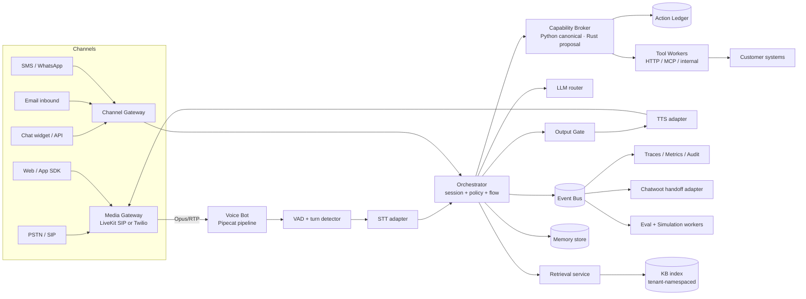

# KLAINT_TARGET_ARCHITECTURE.md

**Status:** target design, not implemented. Klaint today has **no product code** (`sources/wispral/docs/canonical/CURRENT_STATE.md:33-34,105`). Everything here is a specification with testable contracts.

> **Canonical-vs-proposal notice (2026-11-18).** Wispral's ratified planning baseline is **one hardened Python Parlant process with a Python broker package (BN-02, ~800-1,500 LOC estimate) in a separate process, and a ledger implemented as a database table** (`docs/strategy/WISPRAL_COPY_FIRST_STRATEGY.md:50-58,71`; `WISPRAL_MASTER_PLAN_FINAL.md:212,309`). Rust `wispral-policy`/`wispral-journal` are deferred until a second Rust consumer exists. **This document's Rust broker/ledger is an unratified alternative, not an adopted decision.** Where it departs from the baseline it is labelled a proposal. Read `ARCHITECTURE_RECONCILIATION.md` before implementing any of it. The security shape shared with the baseline — separate broker process, capability on every tool, BLOCK where gated, per-tenant isolation — is canonical.

**As of:** 2026-11-18 · **Supersedes:** nothing. **Depends on:** Wispral invariants A1-A15, KL-T3 capability design, KT-01 findings, `ARCHITECTURE_RECONCILIATION.md`.

---

## 1. Non-negotiable design rules

Derived from the binding Wispral documents and the competitor evidence:

| # | Rule | Why |
|---|---|---|
| R1 | The LLM never authorizes an action. Authorization is a signed capability minted by a broker after deterministic checks. | KT-01 proved a forged `customer_id` was accepted by Parlant's tool server and returned data. Prompt instructions are not authority. |
| R2 | Identity comes from an authenticated channel/session, never from model output or request body. | Lorikeet's own doc: "make every sensitive action require a token ... tie the token to the customer ... never from what the AI tells them." Parloa forbids system variables as identity keys. |
| R3 | No hidden egress. Every network destination is declared in a manifest, off by default, visible in the console. | Wispral SI-6 / A10. This is Klaint's structural difference from SaaS competitors. |
| R4 | Output safety must be able to stop text **before** it is delivered. | Parlant 4.0.6 `on_message_generated` BAIL is still observational in STREAM (`core/engines/compass/loop/base_loop.py:2229-2244`). Gate at the reviewer/buffer point or outside the engine. |
| R5 | Every mutating action is idempotent and reconciled. Unknown outcomes are a state, not an exception. | Telecom + payments fail ambiguously. Blind retries double-charge. |
| R6 | Tenant identity is checked at every boundary; no query may run without a tenant predicate. | Competitors claim isolation; Klaint must prove it with a test suite. |
| R7 | Evidence beats assertion: every answer can carry citations; every action carries a receipt. | The market is saturated with unverifiable "guardrails" claims. |
| R8 | Self-host is a first-class deployment, not an afterthought. | No public self-host option was found for any of the three in reviewed sources; regulated buyers are underserved by what is publicly on offer. |
| R9 | Arabic (MSA + Gulf/Levantine/Egyptian) and code-switching are first-class, not a translation layer. | No public dialect evidence was found in reviewed sources; absence of evidence is not proof of absence. |
| R10 | Human ownership is explicit and monotonic (epochs). | Prevents AI/human double-replies during handoff. |

---

## 2. System context and call pipeline



**Turn sequence (text or voice transcript):**

1. Ingest message with channel-authenticated principal + conversation id + ownership epoch.
2. Resolve tenant/agent/config version pinned to the conversation (no hot-swap mid-turn).
3. Classify intent / route deterministically where a flow exists; otherwise LLM planner proposes.
4. Retrieve tenant-scoped knowledge; attach passage ids + version hashes.
5. LLM proposes a response and/or tool calls (never executes).
6. For each tool call: broker validates schema, tenant, session, policy, and business preconditions → mints single-use capability or denies.
7. Tool worker executes with the capability; result is recorded in the ledger with idempotency key.
8. Compose answer with citations; run output gate (policy, grounding, PII, brand, action claims).
9. Release to channel (sentence-committed for voice, full-message for regulated profiles).
10. Emit events; update memory; schedule reconciliation if any effect is unknown.

---

## 3. Component responsibilities

| Component | Responsibility | Explicitly not responsible for |
|---|---|---|
| Channel Gateway | Normalize inbound events, authenticate channel, enforce rate limits, map to conversation | Business policy, identity proofing beyond channel |
| Voice Bot (Pipecat) | Audio transport, VAD, barge-in, STT/TTS orchestration, interruption | Deciding actions, retrieving knowledge, authorization |
| Orchestrator | Session state, flow graph, planning, prompt assembly, composition | Minting capabilities, writing to customer systems |
| Capability Broker (canonical: Python package in a separate process; Rust service = unratified proposal, see `ARCHITECTURE_RECONCILIATION.md`) | Principal resolution, policy checks, capability mint/verify, nonce ledger, audit | Generating text, calling LLMs |
| Tool Workers | Execute one tool with one capability; validate args again; return typed result | Deciding whether the call is allowed |
| Retrieval | Hybrid search, tenant filter, version pinning, citation spans | Answer generation |
| Output Gate | Deterministic + model checks before release; rewrite/escalate/block | Deciding business outcomes |
| Ledger | Event-sourced record of intents, authorizations, attempts, effects, outcomes | Being the system of record for customer data |
| Handoff Adapter | Chatwoot conversation/assignment sync, ownership epochs, summary packet | Being the source of truth for conversation state |
| Eval Workers | Simulations, regression suites, adversarial suites, scoring | Production traffic |
| Console | Authoring, drafts, publish, traces, evals, audit, egress manifest | Runtime enforcement |

---

## 4. Tenancy and principal model

### 4.1 Hierarchy

```
Tenant (billing + KMS + residency)
 └── Workspace (team)
      └── Agent (versioned config)
           └── Channel (chat | voice | email | sms | api | mcp)
                └── Conversation (pinned agent version, ownership epoch)
                     └── EndUser identity (channel-scoped, verified or guest)
```

### 4.2 Principal types

| Principal | Authenticated by | May do | May never do |
|---|---|---|---|
| `operator` | OIDC/SSO (PKCE), MFA | Author, publish, read traces, approve eval gates | Mint runtime capabilities directly; bypass draft/publish |
| `service` | mTLS + short-lived scoped token | Call management API within org/region scope | Act as an end user; read cross-tenant data |
| `runtime` | Session record + signed deployment identity | Process turns for its conversation | Choose another tenant/customer; call tools without capability |
| `end_user` | Channel proof (app SSO reference, OTP, verified call reference, email domain) | Converse, consent, request deletion | Escalate own privileges; act for another customer |
| `agent` | **Not a principal.** Acts under a `runtime` session | Propose text and tool calls | Hold credentials, authorize, or persist secrets |

**Hard rule:** `customer_id` is never accepted from the model, the request body, or a tool argument. It is resolved from `session_id` in the session store, and the broker independently re-resolves it. A tool that needs a customer identifier receives it from the broker's signed context, not from the LLM.

### 4.3 Isolation implementation

- PostgreSQL row-level security keyed by `tenant_id`, plus a repository layer that refuses queries without a tenant predicate.
- Per-tenant KMS data keys; envelope encryption for message bodies and tool payloads.
- Object storage prefix `tenant/{id}/`; signed URLs scoped to tenant.
- Vector index namespace per tenant; no shared ANN graph across tenants.
- Broker resolves tenant from the authenticated deployment token, then verifies the conversation belongs to that tenant.
- A CI "leak suite" runs every query path with tenant A's credentials against tenant B's ids and expects 404/empty, never data.

---

## 5. Capability security (the core differentiator)

### 5.1 Capability shape

Ed25519-signed, CBOR or JCS-canonical JSON:

```json
{
  "v": 1,
  "jti": "01J...ULID",
  "tenant": "t_...",
  "agent": "ag_...",
  "session": "ses_...",
  "conversation": "cnv_...",
  "principal": "end_user:eu_...",
  "tool": "orders.refund",
  "args_digest": "sha256:...",
  "policy_version": "pol_...",
  "issued_at": "2026-11-18T10:00:00Z",
  "exp": "2026-11-18T10:01:00Z",
  "nonce": "base64url-128-bit",
  "single_use": true
}
```

### 5.2 Verification algorithm (broker, fail-closed)

1. Verify signature against tenant public key; reject unknown `kid`.
2. Check `exp` (≤60 s) and `iat` skew (≤5 s).
3. Load session; confirm `session.tenant == cap.tenant`, `session.customer == cap.principal`, `session.agent == cap.agent`, `session.conversation == cap.conversation`.
4. Recompute canonical args digest from the actual tool invocation; compare in constant time.
5. Check `tool` is in the agent's **published** version allowlist and the caller's scope.
6. Check policy version is still active; a policy change invalidates outstanding capabilities.
7. Atomically consume `nonce` in the ledger (`INSERT ... ON CONFLICT DO NOTHING`); a second use is a hard deny.
8. Record `authorization` event with trace id; only then dispatch.

**Deny reasons are enumerated and auditable:** `bad_signature`, `expired`, `replayed`, `args_mismatch`, `tool_not_allowed`, `tenant_mismatch`, `session_mismatch`, `policy_superseded`, `precondition_failed`, `rate_limited`.

### 5.3 What this defeats

| Attack | Result |
|---|---|
| LLM is prompt-injected to call `refund` on another customer | Broker resolves customer from session; args digest includes customer; deny |
| Attacker replays a captured tool request | Nonce consumed; deny |
| Attacker changes amount/order id | Args digest mismatch; deny |
| Compromised tool worker calls broker directly | Worker has no mint authority; only a capability for one call |
| Stale policy after an incident | Policy version check invalidates outstanding capabilities |
| Tool server bound to localhost | Not applicable to Klaint: no HTTP tool server in Klaint's runtime (unlike Parlant 4.0.6, `plugins.py:851`); tool workers are internal services with mTLS |

### 5.4 Tool registry

Each tool declares: JSON Schema for args, side-effect class (`read | write | money | auth | external`), idempotency strategy, required scopes, timeout, retry policy, compensation action (if any), and egress destination. The console shows this as the **egress manifest**; an undeclared destination fails CI and startup.

---

## 6. Guarded tool-calling sequence

```mermaid
sequenceDiagram
  participant U as User
  participant O as Orchestrator
  participant B as Broker
  participant L as Ledger
  participant T as Tool Worker
  participant S as Customer System

  U->>O: "Refund order 48213"
  O->>O: resolve session, tenant, customer, agent version
  O->>O: LLM proposes tool call + args
  O->>B: authorize(tool, args, session, trace)
  B->>B: schema + policy + tenant + session checks
  B->>L: consume nonce, write authorization
  B-->>O: capability (signed, 60s, single-use)
  O->>T: execute(capability, args)
  T->>T: verify capability, re-validate args
  T->>S: idempotent request (Idempotency-Key)
  alt known success
    S-->>T: 200 + effect id
    T->>L: effect(success, provider_ref)
    T-->>O: result
    O->>U: "Refunded $42.00 — receipt R-..."
  else known failure
    S-->>T: 4xx
    T->>L: effect(failed, reason)
    T-->>O: typed error
    O->>U: explain + alternatives
  else unknown (timeout/5xx)
    T->>L: effect(unknown)
    T-->>O: pending
    O->>U: "Submitted; confirming — I'll follow up"
    L->>T: reconciliation job (poll provider, no blind retry)
  end
```

**Contract:** no tool executes without a capability; no capability without a session; no retry of a mutating tool without the same idempotency key and a reconciliation check.

---

## 7. Output safety and streaming

### 7.1 The hard finding

Parlant 4.0.6 still documents that `on_message_generated` BAIL cannot stop streamed text (`src/parlant/core/engines/compass/loop/base_loop.py:2229-2244`; the qualifying sentence is 2234-2238). It *does* provide a pre-emit reviewer gate that buffers streaming output when review is requested (`:2140-2144`). Klaint must not depend on the hook.

### 7.2 Three release profiles

| Profile | Behavior | Use |
|---|---|---|
| `FAST` | Stream tokens; gate at sentence boundaries; first sentence gated before release | Low-risk FAQ, latency-sensitive |
| `GUARDED` (default) | Buffer to sentence, run deterministic checks + optional model check, release; escalate on doubt | Most support |
| `REGULATED` | Buffer full message; gate; only then release; no partial text | Money, health, legal, auth |

**Latency cost (estimates, not measured):** `FAST` adds ~0.1-0.3 s; `GUARDED` ~0.3-0.8 s; `REGULATED` ~0.8-2.0 s. This trade must be explicit per agent, not hidden.

### 7.3 Gate contract

```ts
type GateInput = {
  text: string;
  citations: Citation[];       // passage id + doc version hash + span
  toolResults: ToolResult[];   // with receipts
  policy: PolicySnapshot;      // tenant + agent version + profile
  context: { locale, channel, riskClass };
};
type GateDecision =
  | { allow: true; text: string }
  | { allow: false; action: "rewrite" | "escalate" | "block"; reason: string; safeText?: string };
```

Checks run in order: PII/secret leakage → policy phrases → grounding (uncited factual claim) → action-claim consistency (does the text claim an effect the ledger does not contain?) → brand/tone → optional model judge. **Action-claim consistency** is Klaint-specific: the agent may not say "refunded" unless the ledger has a success effect for that turn.

### 7.4 Failure behavior

- Gate unavailable → fail closed (`escalate`), never release ungated.
- Gate disagrees with itself across retries → escalate with the draft attached, not silently retry forever.
- Two consecutive grounding failures → switch to retrieval-only answer or handoff.

---

## 8. Idempotency, ledger, and unknown outcomes

### 8.1 Event model

```
intent.proposed → authorization.denied | authorization.granted
authorization.granted → attempt.started → effect.known(success|failure)
                                     └→ effect.unknown → reconcile.pending → effect.known
```

### 8.2 Idempotency key

`idem = base32(sha256(tenant | tool | business_key | args_digest))`

- `business_key` is the durable business object (order id, ticket id, appointment id), not the turn id.
- Repeating the same business action from a new turn reuses the key and returns the prior receipt instead of re-executing.
- The ledger is the source of truth for "did this happen?"; the LLM is not.

### 8.3 Reconciliation

- Every `effect.unknown` creates a job with exponential backoff and a hard deadline (e.g., 24 h).
- Read-only status tools are used to determine the outcome; mutating retries are forbidden unless the provider supports idempotency and the key matches.
- If still unknown at deadline: mark `unresolved`, notify a human queue, and never claim success to the customer.
- Compensation actions (cancel/void/refund-reversal) are declared per tool and require a new capability.

### 8.4 Receipts

Every successful effect produces a customer-visible receipt: action, amount/object, timestamp, provider reference, policy version, trace id. This is both UX and audit evidence.

---

## 9. Voice stack and unit economics

### 9.1 Stack choice

| Layer | Choice | License | Reason |
|---|---|---|---|
| Media / pipeline | **Pipecat** | BSD-2 | Turn detection, barge-in strategies, transports, active project |
| WebRTC/SIP transport | **LiveKit** (SIP + WebRTC) or Twilio Media Streams | OSS / commercial | Lorikeet itself uses LiveKit for web voice (SV); LiveKit SIP avoids per-minute media tax at scale |
| PSTN | Twilio (or regional carrier) | commercial | Public rates, global numbers, SIP trunking |
| STT | Deepgram / Azure / provider per language | commercial | Arabic coverage must be benchmarked, not assumed |
| TTS | ElevenLabs / Azure / provider per dialect | commercial | Voice quality + dialect inventory |
| LLM | Router: hosted + self-hosted | commercial/OSS | Cost/latency/quality arbitration; no single-vendor lock |

### 9.2 Published unit costs (accessed 2026-11-18)

| Item | Rate | Source |
|---|---|---|
| Twilio US inbound local | **$0.0085/min** | Twilio voice pricing page [E-TEL-01] |
| Twilio US outbound local | **$0.0140/min** | same |
| Deepgram streaming STT | **$0.0065/min** (list; was $0.0077) | Deepgram pricing [E-TEL-02] |
| ElevenLabs | Creator **$22/mo for 121k credits**; consumption varies by model | ElevenLabs pricing [E-TEL-03] |

**Illustrative 3-minute voice resolution (assumptions, not a quote):**

- PSTN: 3 × $0.0140 = **$0.042**
- STT: 3 × $0.0065 = **$0.0195**
- TTS: ~1,200 characters ≈ 0.02-0.10 → **$0.02-0.10**
- LLM: 3 turns, ~3-8k tokens → **$0.01-0.06**
- Compute/media: **$0.02-0.05**
- **Total ≈ $0.11-0.27 per 3-min call** (≈ $0.04-0.09/min)

Compare Lorikeet voice list at **$1.50 per resolution** (≈3 min average, per its pricing note) [E-LOR-05]. Infrastructure is roughly **7-18%** of that price. The margin is in orchestration quality, not minutes. Klaint's self-host pitch is strongest at high volume and in low-cost regions, not as a "cheaper minutes" story.

### 9.3 Latency budget (target)

| Stage | Target p50 | Target p95 |
|---|---|---|
| VAD end-of-turn | 150 ms | 300 ms |
| STT final | 200 ms | 400 ms |
| Orchestrator + retrieval | 150 ms | 350 ms |
| LLM first token | 350 ms | 800 ms |
| Output gate (GUARDED) | 300 ms | 700 ms |
| TTS first byte | 150 ms | 300 ms |
| Network | 50 ms | 120 ms |
| **End-to-end** | **≈0.9-1.2 s** | **≈2.0-2.5 s** |

Barge-in: stop TTS playback within **250 ms** of detected speech; preserve the interrupted turn as context; never restart the caller.

### 9.4 Privacy boundary

- Media never leaves the tenant's chosen region.
- Recording is opt-in per tenant; default stores transcript + redacted metadata only.
- A `no-egress` mode uses local STT/TTS/LLM only; the console shows which providers are active and what data each receives.
- All provider calls carry a tenant-scoped, revocable credential; no shared global keys.

---

## 10. Channel adapters

| Channel | Inbound | Outbound | Key risks |
|---|---|---|---|
| Web chat | WebSocket/SSE, signed session cookie | Streaming text + citations | XSS, session fixation, widget spoofing |
| In-app SDK | Short-lived end-user token from customer backend | Same | Token leakage; must bind to origin + tenant |
| API | REST + webhook (Standard Webhooks) | JSON + signed callbacks | Replay, SSRF, rate limits |
| Email | Inbound parse + SPF/DKIM/DMARC check | Threaded reply | Sender forgery (identifier, not proof) |
| SMS/WhatsApp | Provider webhook (signed) | Template messages | Opt-out, regional rules |
| Voice | SIP/WebRTC | Audio + DTMF + transfer | Toll fraud, caller ID spoofing, recording consent |
| MCP (agent-to-agent) | OAuth/SSO or scoped token | Tool responses | Confused deputy, scope creep |

All adapters normalize to one `InboundEvent` and emit one `OutboundEvent`; channel-specific code never touches policy.

---

## 11. Chatwoot handoff with ownership epochs

### 11.1 Problem

During handoff, an in-flight AI turn can land after a human has taken over, producing double replies or contradictory instructions. No public documentation of how any of the three prevents this was found in reviewed sources.

### 11.2 Protocol

- Klaint conversation state holds `ownership_epoch` (integer) and `owner` (`ai` | `human:{agent_id}` | `queue:{team_id}`).
- Chatwoot webhooks on `conversation.assignment_changed`, `status_changed`, `message.created` are consumed by the handoff adapter.
- Any ownership change increments the epoch atomically.
- Every AI-generated outbound carries the epoch it was produced under. The channel gateway drops stale epochs.
- On human assignment: AI pauses, publishes a handoff packet (summary, verified identity level, actions + receipts, open questions, citations), and stops generating.
- On return to AI: new epoch, fresh context summary, no replay of stale drafts.
- Human messages are mirrored into Klaint memory as authoritative; AI never overwrites a human statement.

### 11.3 Testable behavior

| Scenario | Expected |
|---|---|
| Human takes over mid-generation | AI draft is dropped; human message is the only reply |
| Human sends then returns to AI | AI sees human message in context; no duplicate |
| Two humans assign/unassign quickly | Epoch increments twice; only latest owner's actions apply |
| Chatwoot webhook delayed | Stale epoch rejected; reconciliation log entry |

---

## 12. Retrieval, knowledge, and citations

- **Ingest:** documents chunked with stable ids; each chunk stores `doc_id`, `version_hash`, `span`, `tenant`, `acl_tags`, `locale`, `effective_at`.
- **Index:** Postgres FTS/BM25 + vector index per tenant; hybrid fusion (RRF) with configurable weights.
- **Freshness:** every answer records the KB snapshot; a stale snapshot beyond the tenant SLO triggers a warning and, for regulated profiles, a refusal to answer from that source.
- **Citations:** the composer must attach a citation for each factual claim. The gate checks that citations resolve to retrieved passages (not hallucinated ids) and that the quoted span supports the claim (model check + human-audited sample).
- **Deletion:** deleting a document invalidates its versions and removes vectors; historical answers keep the citation metadata but mark the source as deleted.
- **Access control:** ACL tags are applied as a pre-filter, not post-filter, so a user can never retrieve a passage they cannot see.

---

## 13. Observability, audit, and evidence

- **Tracing:** OpenTelemetry; one trace per turn; spans for retrieval, LLM, each broker decision, each tool attempt, gate, TTS.
- **Redaction:** PII redaction before export; raw payloads only in tenant-scoped encrypted store.
- **Audit log:** append-only, hash-chained (`prev_hash`), tenant-scoped; records operator actions, publishes, policy changes, capability denials, data exports, deletions.
- **Metrics:** resolution rate, containment, escalation rate, false-action rate, gate block rate, p50/p95/p99 latency, cost per resolution, retrieval hit rate, citation coverage.
- **Evidence export:** a per-conversation bundle (transcript, citations, tool receipts, policy version, trace ids) that a customer can hand to an auditor.

---

## 14. Evaluation and benchmark design

### 14.1 Layers

1. **Unit:** tool schema, broker deny paths, gate rules, redaction.
2. **Scenario:** scripted conversations with expected actions and expected citations.
3. **Adversarial:** prompt injection, false authority, goal switching, data exfiltration, forged identity, replay.
4. **Statistical:** τ-bench-style tasks with a simulated user and a programmatic reward.
5. **Human:** blind Arabic/dialect quality, empathy, escalation judgment.
6. **Production:** shadow traffic, canary, online A/B with opt-out.

### 14.2 Metrics that matter

| Metric | Definition | Gate |
|---|---|---|
| Task success | Scenario goal achieved | ≥ target per suite |
| Action precision / recall | Correct tool calls vs expected | Precision ≥ 0.98 on money tools |
| False action rate | Unauthorized or wrong-object action | **0** on the adversarial suite |
| Hallucination rate | Unsupported factual claims | ≤ 2% on audited sample |
| Citation validity | Citations resolve + support | ≥ 99% |
| Handoff correctness | Right escalation, no double reply | 100% on scripted cases |
| Tenant leakage | Cross-tenant data in any output | **0** |
| Latency | p50/p95/p99 per stage | Budgets in §9.3 |
| Cost per resolution | Infra + model + telecom | Target band |

### 14.3 Arabic/Arabizi pack (Klaint contribution)

- Domains: telecom, retail, banking, healthcare admin.
- Variants: MSA, Gulf, Egyptian, Levantine, Arabizi (Latin script), code-switched Arabic/English.
- Audio: recorded callers, background noise, interruptions.
- Scoring: task success + entity accuracy + dialect naturalness + escalation appropriateness.
- Publish the pack and the harness; do not publish competitor scores without consent.

---

## 15. Console plan

| Area | MVP | Later |
|---|---|---|
| Agent authoring | Flows, policies, tools, knowledge, draft/publish | Visual debugger, diff, AOP import from transcripts |
| Testing | Scenario editor, run, pass/fail, citations diff | Batch suites, CI gate, adversarial library |
| Traces | Turn timeline, retrieval, tool receipts, gate decisions | Cost attribution, anomaly detection |
| Handoff | Chatwoot connect, ownership timeline | Workforce analytics |
| Governance | RBAC, SSO, audit log, egress manifest | Residency zones, BYOK, retention policies |
| MCP control plane | Read-only by default, preview, draft, scoped tokens | SSO-bound assistant sessions |

Design constraints: Arabic RTL first; keyboard navigable; no hidden toggles for safety; every claim in the UI links to evidence.

---

## 16. Testable contracts (acceptance)

| ID | Contract | Pass criterion |
|---|---|---|
| C1 | Forged customer id | A tool call with a customer id not bound to the session returns **zero data and zero effects** |
| C2 | Capability replay | Second use of a capability is denied and logged |
| C3 | Argument substitution | Any change to args invalidates the capability |
| C4 | Expiry | Capability older than 60 s is denied |
| C5 | Stream gate | In `REGULATED`, no text reaches the channel before a gate allow |
| C6 | Action-claim consistency | "Refunded" without a success ledger entry is blocked |
| C7 | Idempotency | Same business action twice yields one effect and the same receipt |
| C8 | Unknown outcome | Timeout produces `unknown`, a reconciliation job, and no success claim |
| C9 | Tenant isolation | Tenant A cannot read/write any tenant B object via API, search, or tool |
| C10 | Egress | Undeclared destination fails startup/CI; runtime blocks it |
| C11 | Ownership epoch | Stale AI turn after assignment change is dropped |
| C12 | Citation validity | Every citation resolves to a retrieved passage; invalid citations block release |
| C13 | Handoff packet | Human receives summary, identity level, receipts, open questions |
| C14 | Arabic eval | Published dialect suite meets agreed thresholds before release |
| C15 | Audit | Every authorization/denial/effect is reconstructible from the ledger |

---

## 17. Prototype boundaries (what NOT to build first)

- Do **not** build a custom LLM or speech model. Use providers; benchmark them.
- Do **not** build a full workforce-management inbox. Integrate Chatwoot core.
- Do **not** build a visual flow designer before the runtime contracts pass.
- Do **not** support every channel at once. Chat + web voice first; email/SMS after.
- Do **not** claim SOC 2, HIPAA, or PCI before audits/attestations exist.
- Do **not** fork Parlant as the security boundary. Use it behind the broker or not at all.

---

## 18. Donor and license decision matrix

| Donor | Decision | Role | License obligation | Risk |
|---|---|---|---|---|
| **Pipecat** | **Adopt** | Voice pipeline, VAD, barge-in, transports | BSD-2 notice | Low; fast-moving API |
| **Chatwoot core** | **Adopt** | Human inbox, assignments, teams | MIT notice; **exclude `enterprise/`** | Medium; Rails ops burden |
| **τ-bench 2.0** | **Adopt** | Evaluation harness, simulated users | MIT | Low; no Arabic pack |
| **Standard Webhooks** | **Adopt** | Outbound event signing | Apache-2.0 | Low |
| **Parlant 4.0.6** | **Conditional / reference** | Optional dialogue-rule engine behind broker | Apache-2.0 | High: fast rewrite, "vibe-coding" direction, stream hook limits |
| **Rasa OSS 3.6.21** | **Reject** | — | — | Maintenance mode; CALM is commercial |
| **LiveKit** | **Adopt (transport)** | WebRTC/SIP | Apache-2.0 (server) | Low/medium |
| **Lorikeet/Parloa SDKs** | **Reference only** | API shape, type semantics | Apache-2.0 | Copying names/UX may create confusion |
| **Decagon Duet CLI** | **No reuse** | Analysis only | Restrictive | Legal |

### Clear Rasa recommendation

**Do not use Rasa Open Source.** It is explicitly in maintenance mode, its last commit is 2025-12-18, and the vendor's own roadmap points to the commercial CALM/Hello Rasa. Building Klaint on it would inherit a legacy NLU/story model and a dead-end upgrade path. If Klaint needs a rule/flow engine, use an in-house deterministic graph plus an optional Parlant adapter, and keep the authorization boundary in Klaint's broker.

---

## 19. Migration choices

| Choice | Option A | Option B | Recommendation |
|---|---|---|---|
| Orchestrator language | Python (speed, AI ecosystem) | Rust (Wispral A11) | **Canonical: Python service + Python broker in a separate process, DB ledger** (`COPY_FIRST_STRATEGY:50-58,71`). Rust broker/ledger is an **unratified REA proposal** — not adopted. |
| Dialogue engine | Wrap Parlant (canonical) | Own flow graph (REA proposal) | **Canonical: wrap Parlant v4.0.2 with the broker as sole executor.** An own graph would be a new, unratified decision; if pursued, it needs an ADR and a KT-01b-equivalent proof. |
| Transport | LiveKit | Twilio Media Streams | **LiveKit SIP** at scale; Twilio for coverage/fallback |
| Vector store | pgvector | dedicated vector DB | **pgvector** until >50M chunks; simpler tenancy/RLS |
| Queue/event bus | Postgres outbox + NATS | Kafka | **Outbox + NATS** for MVP; Kafka only if volume demands |
| Human inbox | Chatwoot | build | **Chatwoot core** |
| Policy engine | OPA/Rego | in-process | **Canonical: Python policy module in the broker.** In-process Rust is the unratified proposal; OPA only for later admin policy. |

---

## 20. Threat model additions (beyond Wispral KL-T1..KL-T11)

| Threat | Vector | Control |
|---|---|---|
| T-A | Model-injected tool call to wrong customer | Capability bound to session; broker re-resolves identity |
| T-B | Replay of signed tool request | Nonce ledger; 60 s expiry; args digest |
| T-C | Malicious MCP server returns instructions | Treat tool output as untrusted data; strip control tokens; gate; no tool output can mint capabilities |
| T-D | Cross-tenant retrieval via embeddings | Pre-filter by tenant + ACL; namespace isolation; leak suite |
| T-E | Handoff double-reply | Ownership epochs; stale drop |
| T-F | Egress via "helpful" tool or SDK telemetry | Egress manifest; network policy; no default telemetry |
| T-G | Cost/DoS via long calls or tool loops | Per-turn tool budget; execution caps; rate limits; kill switch |
| T-H | Model provider retention | Zero-retention contracts; self-host option; redaction |
| T-I | Console privilege escalation | SSO + RBAC + four-eyes publish for regulated tenants |
| T-J | Webhook forgery | Standard Webhooks signature + timestamp tolerance |

---

## 21. Anti-patterns explicitly rejected

1. **"Guardrails in the prompt."** Rejected. Prompts are requests, not enforcement.
2. **"The model knows the customer id."** Rejected. Identity is resolved by the broker.
3. **"Retry the refund."** Rejected. Unknown outcomes are reconciled, not retried.
4. **"Stream everything for latency."** Rejected for regulated profiles. Latency is traded explicitly.
5. **"We'll add self-host later."** Rejected. Tenancy and egress are architectural from day one.
6. **"Arabic is just another locale."** Rejected. Dialect, Arabizi, RTL, and code-switching need their own evaluation.
7. **"Fork Parlant and patch it."** Rejected as a security strategy. The boundary must be outside the engine.

---

## 22. Open design questions

| # | Question | Owner | Needed by |
|---|---|---|---|
| Q1 | LiveKit SIP vs Twilio Media Streams for first PSTN market? | Voice lead | Phase 2 |
| Q2 | Which Arabic STT/TTS providers pass the dialect suite? | ML lead | Phase 4 |
| Q3 | Is Parlant's rule engine worth an adapter after MVP? | Architecture | Phase 3 |
| Q4 | Chatwoot hosted vs embedded Rails for self-host packaging? | Platform | Phase 1 |
| Q5 | Minimum viable compliance evidence for EU public sector? | Security | Phase 5 |
| Q6 | Do we expose action receipts to end customers or only auditors? | Product | Phase 2 |
